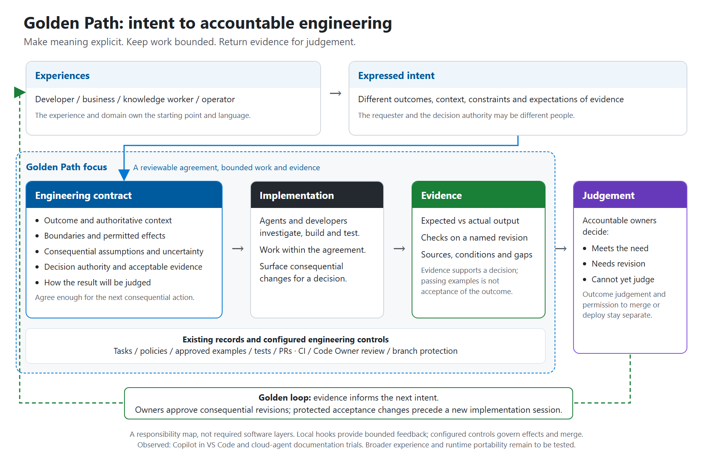
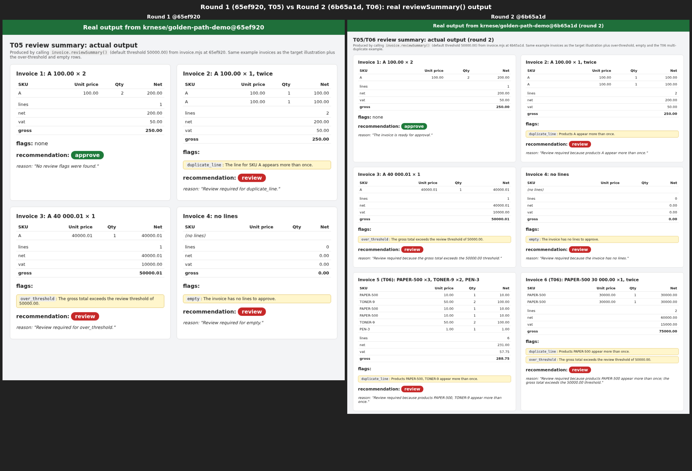

# Golden Path (preview)

**Connect intent to accountable engineering.**

Golden Path is a lightweight engineering method with optional checks. It helps people turn what they need
into a clear agreement for engineering work, preserve that agreement through implementation, and return
evidence to the people responsible for judging the result.

Intent can begin in a developer tool, a business process, an analytical task or an operational investigation.
Those starting points can carry different outcomes, context, constraints and expectations of evidence.
Golden Path helps make the consequential meaning explicit before work proceeds:

- **Agree what matters.** Establish the intended outcome, authoritative context, what must remain true,
  which actions are permitted, who has decision authority, and what evidence will support a judgement.
  Surface assumptions and uncertainty that could change the next step.
- **Keep implementation within the agreement.** Agents and developers investigate, build and test inside
  the delegated boundary. A consequential change goes back to the appropriate owner.
- **Return evidence for a decision.** Show actual results against agreed examples, identify the checked
  revision, and explain gaps. Existing engineering systems check the change; accountable owners judge
  whether it meets the need. Merge and deployment permissions remain separate.

This **engineering contract** is an agreement held in your existing tasks, policies, approved examples,
tests and review records. It can start with a bounded investigation and become more precise as you learn.
The person expressing the need may differ from the people authorised to approve its rules or effects.

The kit makes one part concrete: **the person responsible for a rule approves what it means; the implementing
agent works to that target.** In a configured checked setup, protected acceptance, required checks and review
help preserve it. Passing the examples provides evidence for the owner's judgement.

Start with one useful task in Copilot's normal agent in VS Code. Describe the outcome in your terms,
agree examples of a good result, and use the engineering controls your project already has.

**[Walk through your first task](docs/USER-GUIDE.md)** · **[Installation choices](#quickstart)** ·
**[Why it works this way](docs/background.md)**

**Two ways to start:** the simple method adds guidance for the conversation; checked completion adds
automatic feedback. Protected acceptance and required GitHub review are a further configuration step.
No option makes passing tests a substitute for your judgment.



The diagram maps responsibilities, not required software layers. The agreement lives in existing records;
the local guard and stop gate provide bounded feedback, and configured GitHub controls govern merge.
The method can travel with the work; enforcement depends on the host and configured controls.
Broader experience and runtime portability remain to be tested. Each claim and gap is listed in
[overview claims](docs/overview-claims.md).

## What using it feels like

1. **Say what you want.** "Make our invoice screen easier to understand. Keep the calculations unchanged."
2. **Agree a few examples.** "If a product appears twice, flag it for review and name the product."
3. **Let Copilot build, then look at the result.** "Show me the real output for those examples. What is still uncertain?"

Your developer or Copilot can help turn examples into tests; you approve their meaning. If the result is
not quite right, give the next useful piece of feedback. If that changes protected acceptance, its owner
approves the revision first and the next implementation starts in a new session.

The [first-task guide](docs/USER-GUIDE.md) has prompts you can copy, including a request for Copilot to help
with setup. Technical setup and commands are separate from the everyday conversation.

## See it work

In a real trial, one sentence from Marketing ("I need invoices to be as simple as possible, so humans can
immediately understand and approve/reject them…") became owner-approved acceptance tests. Copilot implemented
them in VS Code on Windows without touching them. The real output went back to Marketing, and Marketing's
follow-up became the next round.



**[Walk through the golden loop, step by step →](docs/examples/golden-loop/README.md)** It covers who decided
at each step, the screenshots, the gate verdicts, and what the trial does and doesn't prove.

## What you get

- **A target you can understand.** Business examples become tests approved by the person responsible for the
  rule. These are called *acceptance tests*: examples of what a correct result should do. With CODEOWNERS
  and branch protection set up, changing them takes that owner's Code Owner approval on the PR's current head commit
  ([authorised revision](docs/LEVEL-2.md#changing-acceptance-tests-on-purpose-authorised-revision)).
- **No quiet change to agreed examples.** In the checked setup, the guard denies common acceptance-edit paths
  and names the owner.
  Integrity checks compare against the commit the session started from, so committing an acceptance edit
  doesn't hide it. Protection is heuristic, not tamper-proof
  ([what Level 2 does](docs/LEVEL-2.md#what-level-2-does-exactly)).
- **An honest result, including uncertainty.** Unreadable evidence is UNVERIFIED and exhausted retries are FAILED,
  never an implicit pass. The stop gate blocks red checks within a bounded retry budget; a host timeout can
  allow stopping. An acceptance failure names the comparison base and what to do next.
- **Your normal review still matters.** Branch protection, CODEOWNERS and required CI stay the authority. An
  optional workflow re-runs the checks against the PR base (`--with-ci`).
- **Works with Copilot's default agent.** No special agent to pick and no new runtime
  ([details](#works-with-your-default-agent)).
- **Small enough to review.** One Node.js script with no npm packages, a conflict-refusing installer and a clean
  uninstall. CI runs the implementation tests on Ubuntu and Windows, Node 22 and 24.
- **Evidence back to the owner.** The method's Report step says what changed, which checks passed on which commit
  and what is still unproved. The [walkthrough](docs/examples/golden-loop/README.md) shows this in practice.

## Quickstart

Needs Node.js 22+ and git, on any OS. From a clone of this repository:

**New here?** The [first-task guide](docs/USER-GUIDE.md) shows what to say to Copilot,
how to agree examples and how to review the result, without starting with this project's test suite.
For the method-only starting option:

```bash
node plugin/install.mjs --target "<your-repo>" --level 1
```

This adds the skill and instructions, not automatic checks or protected acceptance.
For checked completion:

```bash
node plugin/install.mjs --target "<your-repo>" --level 2 --check "<fast-check-command>"
```

**This installs checked completion, not owner-controlled acceptance.** Replace the placeholders with your
repository and an existing fast test command. No business acceptance paths or owner are configured by this
command. Add `--dry-run` to preview, or use `--level 1` for the method only. If your developer tests are not
under `tests/`, add `--protected "<your test folder>/**"` (for example `test/**`); the installer warns when the
protected paths don't exist, because weakened tests there would go unnoticed.

For **owner-controlled acceptance**, first agree examples and approve their executable tests. On a fresh
installation, supply the paths, named owner and existing acceptance command:

```bash
node plugin/install.mjs --target "<your-repo>" --level 2 --check "<fast-check-command>" --acceptance-path "acceptance/**" --acceptance-owner "<named-owner>" --acceptance-command "<acceptance-test-command>" --with-ci
```

The placeholders are commands and ownership you supply, not scripts included by the kit. Both commands plus
integrity checks share the hook budget (default 100 seconds). Keep heavier suites in separate required CI
checks. Rerunning the installer **does not overwrite existing configuration**, even with new flags.

**Finish setup:** configure CODEOWNERS, required CI and Code Owner review; verify refusal and legitimate
owner revisions using the **[adoption checklist](docs/ADOPTION.md)**. The installer does not apply GitHub
settings. Start a new agent session after an owner-approved acceptance revision.

To see the mechanism before configuring your own repository, build the ready-made demo:

```bash
node examples/make-demo.mjs ~/golden-path-demo
cd ~/golden-path-demo
node simulator/refusal_scenario.mjs
code .
```

PowerShell equivalents for the first two lines: `node examples\make-demo.mjs "$HOME\golden-path-demo"` and
`Set-Location "$HOME\golden-path-demo"`. The demo acceptance starts intentionally red; the refusal scenario
checks the guard and backstop, not a completed business feature.

## What's verified today

- *Shipped and tested:* the skill and instructions (`plugin/skills/golden-path/`), the L2 guard and stop gate
  (`plugin/scripts/gate.mjs`; tests in `tests/kit.test.mjs` such as "the stop gate blocks while checks are red,
  then allows once they are green" and "editing, creating or absolute-path editing an acceptance test is
  denied and names the owner"), the installer (`plugin/install.mjs`), and the invoice demo with its scripted
  refusal scenario (`examples/make-demo.mjs`, `simulator/refusal_scenario.mjs`). Verified with Copilot in VS Code.
- *Run end to end in a real trial:* the golden loop, **twice**, with Copilot's default agent in VS Code on
  Windows (14 October 2026). Each round went from intent, to an acceptance-only PR written by an agent outside
  the repo, to review, owner merge, implementation and evidence back to the owner. Copilot passed 18/18 and then
  26/26 acceptance tests and changed only implementation files. The acceptance files matched a fresh build byte
  for byte. The gate correctly refused an acceptance change that landed mid-session.
  *Limits:* one model, one task, a demo repository, and one person playing the owner. "Immediately
  understandable" is the owner's judgement, not a test result. Nothing about productivity was measured. The
  agent never tried to change acceptance, so refusals are shown by the scripted scenario and kit tests, not by
  the trial. Details: [the walkthrough](docs/examples/golden-loop/README.md).
- *Your GitHub settings:* CI, branch protection and Code Owner review. The kit adds no gate of its own.
- *Also observed:* documentation-only Golden Loop trials with the Copilot cloud agent, including evidence
  handoff failures and a later end-to-end loop with the owner's decision recorded. These establish those
  runs, not general reliability; see the [evidence summary](docs/evidence.md#cloud-agent-golden-loop-trial-2026-10-26).
- *Target model, not yet validated:* reliable translation across different starting experiences, broad
  model and runtime portability, and measured outcomes (Level 3 is guidance only). Domain ownership is part
  of the method; the kit packages repository controls rather than domain-specific workflows.

Every element of the overview is checked in [docs/overview-claims.md](docs/overview-claims.md).

## Two ways to use Golden Path

1. **Fork or clone this repository.** Golden Path is already
   installed here at Level 2 (`.github/skills/golden-path/`, the marked block in
   `.github/copilot-instructions.md`, the hook in `.github/hooks/`, config in `.golden-path/config.json`,
   whose check is a **fast** packaging + installer + self-install subset that fits the hook budget; the full suite stays in CI). Those are installed *copies*; **`plugin/` is the source of
   truth**. After changing anything under `plugin/`, rerun `node plugin/install.mjs --target .` and commit;
   a test (`tests/self-install.test.mjs`) fails in CI if the copies drift.
   This repository's own configuration protects developer tests but has no business acceptance paths or
   acceptance command; cloning it does not define acceptance for your business.
2. **Add it to your own repository** with `node plugin/install.mjs --target <your-repo>` (levels below). It
   copies the same files into *your* repository's `.github/` (and `.golden-path/` at L2). Paths such as
   `.github/skills/golden-path/` below mean those files in your repository after install.

A standalone VS Code plugin that does not need repository files is being explored.

## What this means in practice

For readers who want the implementation detail, each part maps to something concrete:

- **"A lightweight method with optional checks."** One installer (`plugin/install.mjs`) adds the
  `golden-path` skill under `.github/skills/` and, at L2, one optional hook under `.github/hooks/`
  (Node.js script, no npm packages) to the agent you already use.
- **"Intent in the owner's terms."** The requester states the need; the people responsible for its rules
  and effects approve the relevant meaning and boundaries. In the invoice demo, the fictional finance owner's
  [T01 examples](examples/invoice-demo/acceptance/EXAMPLES.md#t01-percentage-discount-per-line) define a
  per-line percentage discount; the task [`examples/invoice-demo/tasks/T01.md`](examples/invoice-demo/tasks/T01.md) points the
  agent at them and says not to change them.
- **"Reviewable engineering acceptance."** The examples become acceptance tests the expert owns. With a
  CODEOWNERS entry for the acceptance paths and branch protection requiring Code Owner review, a change to
  those tests needs an approval from their Code Owner on the PR's current head commit
  ([docs/LEVEL-2.md](docs/LEVEL-2.md)).
- **"The controls your project already has."** The L2 hook provides fast feedback inside the agent session.
  The binding boundary is your branch protection, Code Owner review and required CI checks. Golden Path
  connects approved acceptance to those controls, with merge and deployment authority kept separate.

**Limit:** the tests prove the business rule only as far as the expert wrote it down. Cases the examples
don't cover are not checked.

## Works with your default agent

You don't need to select a special agent in Copilot; the default agent picks Golden Path up from files in
the repository:

- **Method:** the skill lives in `.github/skills/golden-path/`, and the installer adds a marked pointer to it
  in `.github/copilot-instructions.md` (and `AGENTS.md` if present). VS Code discovers skills in
  `.github/skills/` and includes these instruction files automatically
  ([skills](https://code.visualstudio.com/docs/copilot/customization/agent-skills),
  [custom instructions](https://code.visualstudio.com/docs/copilot/customization/custom-instructions)).
  Discovery makes the skill available; it does not guarantee the model uses it on every prompt.
- **L2 hook:** it is a workspace hook file, `.github/hooks/golden-path-loop.json`. VS Code loads
  hooks for the selected harness. Golden Path was trialled with Copilot's default agent; file discovery alone
  does not establish compatibility with another harness. Validate events, payloads and blocking decisions
  when changing clients or harnesses ([hooks](https://code.visualstudio.com/docs/agent-customization/hooks)).
  The VS Code hooks experience is **preview**.
- **Custom agent:** `golden-path.agent.md` (`--with-agent-preset`) is an optional preset for teams that
  want a named agent that always applies the skill. Nothing depends on it.

Today this depends on files committed to your repository (in this repository they are already committed).

Golden Path adds one skill, and optionally one hook script, to the agent you already use. It does not replace
your agent, your CI or your review process.

It is complementary to [Spec Kit](https://github.com/github/spec-kit) and
[Kiro specs](https://kiro.dev/docs/specs/), which structure requirements, implementation and verification.
Golden Path focuses on who may revise owner-approved executable acceptance. Native hooks and ordinary
acceptance tests, CODEOWNERS and CI already provide the underlying controls; the kit packages one way to
connect them. This is not a claim that other tools lack equivalent protection.

## How it works

1. **Intent, context and boundary.** Establish the outcome, authoritative sources, permitted effects and
   consequential unknowns for the next increment. Agree examples with the people responsible for their
   meaning (see [`examples/invoice-demo/acceptance/EXAMPLES.md`](examples/invoice-demo/acceptance/EXAMPLES.md)).
2. **Approved acceptance tests.** For protected acceptance, the examples become tests in a separate change
   before the implementation session. The owner approves their meaning; a developer checks the translation.
   The implementing agent may read and run them, not change them. A needed revision goes back to the owner.
3. **Implementation with bounded feedback.** In the verified Copilot setup, L2 blocks red checks within its
   retry budget and records failure or uncertainty explicitly. Golden Path does not pick the model.
4. **Evidence in the review record.** Show expected versus actual output, which checks passed on which
   revision, uncovered cases and what remains uncertain.
5. **Accountable judgement.** The owner decides whether the result meets the need, needs revision or cannot
   yet be judged. Technical review, merge and deployment follow their own existing permissions and controls.

The **golden loop** returns evidence to the owner and turns their next decision into the next increment.
It can begin inside or outside the repository. When protected acceptance changes, its owner approves a
separate revision before a new implementation session begins. The
[two-round trial](docs/examples/golden-loop/README.md) demonstrates this on one demo; the
[cloud-agent trials](docs/evidence.md#cloud-agent-golden-loop-trial-2026-10-26) extend the observations to
documentation tasks. Broader experience support and incremental benefit remain unproved.

## Three adoption levels

No level requires a higher one. Run the installer from a clone of this repository; `<repo>` is your
repository. It writes only `golden-path`-namespaced files, appends a marked block to
`.github/copilot-instructions.md`, `AGENTS.md` (if present) and, at L2, `.gitignore`, and refuses to write anything
on a conflict. Add `--dry-run` to preview.

| Level | What you get | Runtime |
|---|---|---|
| **L1 Method** | The `golden-path` skill (Intent → Context → Boundary → Acceptance → Report) in `.github/skills/golden-path/` | none |
| **L2 Checked completion** | L1 + one stop-gate hook that runs your existing checks when the agent tries to finish, with optional protected acceptance tests | Node.js 22+, no npm packages |
| **L3 Learning and measurement** | A guide to running a matched experiment (Golden Path vs your plain agent) with worktrees, transcripts, git and CI | docs only |

### L1: method, no runtime

```bash
node plugin/install.mjs --target <repo> --level 1
```

Or copy `plugin/skills/golden-path/` to `.github/skills/golden-path/` in your repository by hand.

### L2: checked completion

**Recommended adoption path.** Use the [adoption checklist](docs/ADOPTION.md) to turn installation into a
verified owner-controlled acceptance workflow.

```bash
node plugin/install.mjs --target <repo> --level 2 --check "<your test command>"
```

With expert-owned, protected acceptance tests and the optional CI workflow:

```bash
node plugin/install.mjs --target <repo> --level 2 --check "npm test" \
  --acceptance-path "acceptance/**" \
  --acceptance-owner "Finance: Ingrid Berg" \
  --acceptance-command "npm run test:acceptance" \
  --with-ci
```

**Choose fast local commands.** The stop gate shares one `hook_budget_sec` (default 100) across `--check`,
the acceptance command, integrity and git; a command that overruns is stopped and recorded as UNVERIFIED,
not as a failing test. Put heavier suites in separate required CI checks. This repository's own gate check
runs only the packaging, installer and self-install tests (`--test-name-pattern="^(Packaging|Installer|self-install)"`);
the required "Kit guarantees" CI jobs still run the full suite on Ubuntu and Windows.

- `--with-ci` adds `.github/workflows/golden-path-check.yml` to your repository, which re-runs the checks against the PR base
  commit. Make it a required status check.
- **After the owner changes acceptance, start a new agent session.** The gate compares with the commit the
  session started from, so an acceptance commit made mid-session fails, even the owner's.
- The protected-test checks are **heuristics**: they catch the common ways an agent edits or weakens a test,
  not every workaround.
- Optional extras: `--with-reviewer` (reviewer agent), `--with-agent-preset` (custom agent; Copilot's
  default agent works without it).
- Remove: `node plugin/install.mjs --target <repo> --uninstall` (`--force` if files were modified,
  `--purge` to also delete `.golden-path/config.json`).
- Exact gate behaviour, manual copy-in, the VS Code Agent Plugin route and the authorised acceptance-revision
  flow: [docs/LEVEL-2.md](docs/LEVEL-2.md).

### L3: experiment guide, docs only

Nothing to install (the installer rejects `--level 3`). Install L2, then follow
[docs/LEVEL-3-EXPERIMENTS.md](docs/LEVEL-3-EXPERIMENTS.md). The guide includes a
business-and-engineering experiment roadmap and a first pilot: understand an
existing system, resume in a fresh session, and show evidence for the agreed
outcome. These are proposed experiments, not demonstrated benefits.

## Optional: local-model skill

If someone wants to run the agent on a local model (privacy, offline work, cost, experimentation), add the
recommend-only [`golden-path-local-models`](plugin/optional/skills/golden-path-local-models/SKILL.md) skill
at any level:

```bash
node plugin/install.mjs --target <repo> --level 1 --with-local-models
```

It checks the environment and an endpoint and recommends local, hosted or no model per task. It never
selects or switches the model; that is the host's job. L2 checks run the same regardless of model.

## Limits

- **Hooks are fast feedback, not authority.** They run inside the agent session, can time out (and then
  fail open) and can be worked around.
- **The durable boundary is yours:** branch protection, Code Owner review and required CI checks.
  Golden Path documents that boundary; it does not build it.
- **Passing tests is not business correctness.** It shows the expert's executable examples are met, not
  that they capture what customers need, nor that the change may be merged, released or deployed.
- **Preview.** VS Code agent hooks are a preview feature; see [VERIFY-IN-VSCODE.md](VERIFY-IN-VSCODE.md)
  for what still has to be checked on a signed-in install.
- **Benefit is unproved.** This repository's own experiments found no measurable benefit from method
  guidance; see [docs/evidence.md](docs/evidence.md).

## Examples

- **[Invoice demo](examples/invoice-demo/README.md)** (L2, about 10 minutes; needs Node.js 22+ and git,
  any OS including Windows; no Python): a fictional finance owner's examples become protected tests, and a scripted agent is refused
  when it tries to edit one.

  ```bash
  node examples/make-demo.mjs ~/golden-path-demo
  cd ~/golden-path-demo
  node simulator/refusal_scenario.mjs
  code .   # then ask Copilot's default agent: "Do tasks/T05.md" (or T01 / T06; all are enabled and red)
  ```

- **[The golden loop, end to end](docs/examples/golden-loop/README.md)**: a real two-round trial with Copilot in
  VS Code on Windows (intent → acceptance PR → review → build → evidence → next intent), with screenshots and
  limits.

- **[Connecting your own reasoning boundaries](docs/examples/hybrid-workflow.md)**: one adopter's workflow
  (own agents → PR → Copilot → reviewable PR → human merge) mapped onto Golden Path levels and files.

## How we maintain this repository

**These checks maintain the Golden Path kit; they do not establish that an adopter's business
requirements are met.** The optional [adopter workflow](plugin/extras/workflows/golden-path-check.yml)
installed by `--with-ci` runs that project's configured commands and acceptance against its PR base.
It is not this repository's [hygiene workflow](.github/workflows/golden-path.yml).

### Checks, evidence and limits

| Action and source | When it runs | Required or advisory | Evidence and limit |
| --- | --- | --- | --- |
| Local guard and stop gate: [hook registration](.github/hooks/golden-path-loop.json), [configuration](.golden-path/config.json) | Tool calls and session completion in a supporting client; `check --base` can also run manually | Local feedback, not merge authority | Guard messages and local gate outcomes. The fast check runs packaging, installer and self-install tests, not the full CI suite. Protection is heuristic and retries/timeouts are bounded. |
| Patch hygiene: [hygiene workflow](.github/workflows/golden-path.yml), `git diff --check` | Push, PR and manual workflow dispatch | Required status check on `main` | Whitespace verdict against the event baseline; latest-commit fallback when there is no event base. It does not check engineering quality or business acceptance. |
| Kit guarantees: [hygiene workflow](.github/workflows/golden-path.yml) | Push, PR and manual dispatch; Ubuntu/Windows with Node 22/24 | All four matrix checks required on `main` | Full kit tests, installed-copy consistency and demo checks. Test results cover specified mechanisms, not universal reliability. |
| Demo verification: [demo builder](examples/make-demo.mjs) and generated refusal scenario | Inside each Kit guarantees job; the bash wrapper is also checked on Linux | Part of the required matrix, not a separate required status | Frozen hashes verified, scripted edits refused, developer tests green. Enabled demo acceptance must be red because the baseline feature is unfinished; this is not a business implementation result. |
| CI result summary: [test-summary.mjs](.github/scripts/test-summary.mjs) | After the kit test step, including when it fails | Reporting within the matrix, not an independent approval | TAP counts and test areas in the job summary. Inspect failed steps and logs too; the summary does not approve the outcome. |
| Static landing page: [site workflow](.github/workflows/site.yml) | PRs and pushes affecting `site/**`, `README.md`, `docs/examples/golden-loop/**` or the workflow; pushes exclude `gh-pages`; also manual dispatch | Not currently a required status in `main` rules | Site tests, build and verifier on Ubuntu/Node 22. A green result is not a deployment. |
| Golden Loop: [golden-loop workflow](.github/workflows/golden-loop.yml), [script](.github/scripts/golden-loop.mjs) | `golden-loop` issue closed; PR events (`pull_request_target`) | Not a required status | Reopens an issue closed by a merged change before the owner, named by @username, records `Owner judgment: meets the need`. Fails a PR working on a `golden-loop` issue unless every example has a table row with Expected and Actual filled in; lookup failures are UNVERIFIED. The workflow file and script both come from the base branch and no PR code is run, so a PR cannot change the check that judges it. Checks presence, not truth; see the [issue loop](docs/LEVEL-3-EXPERIMENTS.md#keep-the-golden-loop-in-the-issue). |

Both push and PR events can produce check runs for the same commit. Read the PR's checks at the
reviewed head revision; a prior local run or a different commit's green result is not its CI record.
This repository's local configuration protects `tests/**` but has **no business acceptance paths
or acceptance command**. A green gate therefore does not mean business acceptance was exercised.

### Reproduce checks and update generated files

Run from the repository root with Node.js 22+ and git. These PowerShell commands check whitespace
and run the configured fast check plus integrity checks against the fetched default-branch baseline:

```powershell
git fetch origin main
git diff --check origin/main HEAD
node .github\hooks\golden-path\gate.mjs check --base origin/main
```

Run each command only after the preceding command succeeds. The gate's manual comparison base is
not a replacement for the session-start baseline used by the stop hook. For the full kit test list,
self-install tests and demo commands, use the [hygiene workflow](.github/workflows/golden-path.yml);
for site commands use the [website maintainer guide](site/README.md#build-and-verify).

`plugin/` is the source of truth for installed kit files. After changing it, regenerate with
`node plugin/install.mjs --target .`, include the generated changes in the same reviewed change,
and run `node --test tests/self-install.test.mjs`. Do not hand-edit the installed copies.
If the installer refuses a locally modified managed file, resolve the source/copy difference
explicitly rather than overwriting it or weakening the consistency test.

### Review rules and workflow maintenance

**Live settings checked on 26 October 2026:** `main` requires a PR, the
`Patch hygiene: no whitespace errors` check and the four `Kit guarantees` checks
(Ubuntu/Windows, Node 22/24). Automatic Copilot review is configured. Required approving reviews
are **zero**, and Code Owner approval is **not required**, deliberately for this single-maintainer
repository. CODEOWNERS routes ownership; its existence alone does not enforce owner approval.
See the [single-maintainer explanation](docs/LEVEL-2.md#code-owner-review-for-single-maintainer-repos).
This snapshot is not a claim that all administrator or ruleset bypass paths were audited.

When changing governance, verify live settings rather than relying on this snapshot, and update
the inventory in the same reviewed change. Useful read-only checks are `gh workflow list` and
`gh api repos/krnese/golden-path/rules/branches/main`. Review and merge remain separate from
business-owner judgment.

The three checked-in workflows use `actions/checkout` and `actions/setup-node`, pinned to full commit
SHAs, with `persist-credentials: false` and the narrowest token permissions each job needs
(`contents: read`; the Golden Loop issue job alone has `issues: write`). These restrict the default token's
scope and avoid leaving checkout credentials in git configuration; they do not make executed code
safe. Review pin updates through normal PRs, checking the relevant upstream release and all workflow
references, including the optional adopter template. The workflow files remain authoritative for pins.

GitHub-managed Copilot review, Copilot cloud-agent and Pages workflows also appear in Actions;
they are platform integrations, not additional checked-in hygiene YAML. Website publication is
a separately authorized operation documented in [Publish on GitHub Pages](site/README.md#publish-on-github-pages).
Site checks neither publish the site nor authorize merge or deployment.

## Documentation

| Document | What it covers |
| --- | --- |
| [Your first task](docs/USER-GUIDE.md) | What to tell Copilot, how to agree examples and how to look at the result |
| [How we maintain this repository](#how-we-maintain-this-repository) | Local checks, required CI, evidence, review settings, generated copies and workflow maintenance |
| [Website](site/README.md) | Build and publish the one-page static site; connect a custom domain |
| [Adoption checklist](docs/ADOPTION.md) | From installation to verified owner-controlled acceptance in your repository |
| [Level 2 reference: checked completion](docs/LEVEL-2.md) | Gate behavior, protected paths, CI and authorized acceptance revisions |
| [The golden loop, end to end](docs/examples/golden-loop/README.md) | Real two-round demo trial, decisions, evidence and limits |
| [How your acceptance suite grows itself](docs/how-acceptance-evolves.md) | Owner-approved acceptance accruing one task at a time |
| [Evidence](docs/evidence.md) | What is and is not proved, including negative findings |
| [Level 3: learning and measurement](docs/LEVEL-3-EXPERIMENTS.md) | Plain-language experiment roadmap, first brownfield pilot and matched comparisons; docs only |
| [Verify in VS Code](VERIFY-IN-VSCODE.md) | Signed-in client verification checklist |
| [Invoice demo](examples/invoice-demo/README.md) | Example app, tasks, owner acceptance and demo builders |
| [Connecting your own reasoning boundaries](docs/examples/hybrid-workflow.md) | One adopter's workflow mapped onto the kit |
| [Background](docs/background.md) | History and how the idea evolved under evidence |
| [Overview claims](docs/overview-claims.md) | Diagram claims checked against the kit, with gaps labeled |
| [Golden Path skill](plugin/skills/golden-path/SKILL.md) and [method](plugin/skills/golden-path/references/METHOD.md) | Agent-facing guidance |
| [Changelog](CHANGELOG.md) | Version history |

## Repository layout

- `plugin/`: the kit (skill, `plugin/scripts/gate.mjs` hook, hooks JSON, optional agents and skills, `install.mjs`).
- `docs/`: level 2 reference, level 3 guide, evidence, examples.
- `examples/`: the invoice demo.
- `tests/kit.test.mjs`: kit tests (`node --test tests/kit.test.mjs`).
- `tests/self-install.test.mjs`: checks the installed copies below match `plugin/`.
- `.github/skills/golden-path/`, `.github/hooks/`, `.github/prompts/`, `.github/copilot-instructions.md`, `.golden-path/`:
  the kit installed into this repository (generated from `plugin/`; do not edit by hand).
- `archive/`: earlier versions and the original experiments (history, not instructions).
- [CHANGELOG.md](CHANGELOG.md): version history.

## Contributing and feedback

Trial reports, bugs and cases where plain practice works just as well are all welcome as
[GitHub issues](https://github.com/krnese/golden-path/issues). Say what you expected, what happened, and
your agent, client and model when known. Remove secrets and customer data first. Pull requests go through
the same review and CI as everything else; run `node --test tests/kit.test.mjs` before opening one.

## License

Golden Path is licensed under the [MIT License](LICENSE), copyright 2026 Kristian Nese.
Third-party references retain their own terms; this license does not grant rights to external material.
