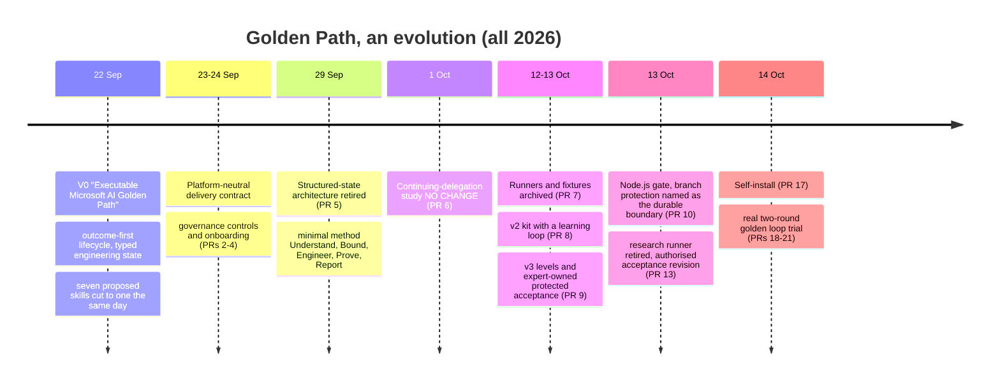
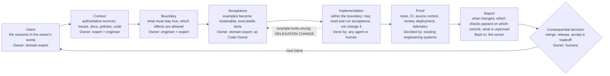
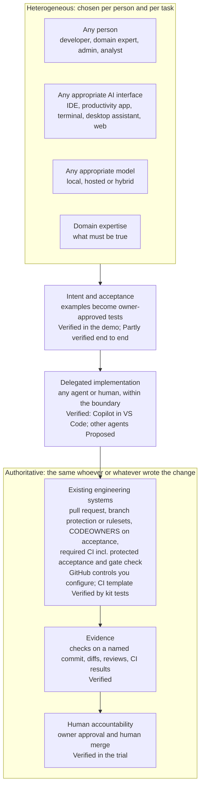
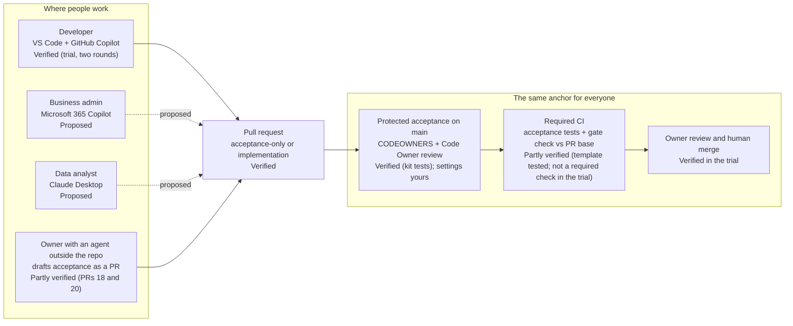

# Background of Golden Path

← [Golden Path README](../README.md) · [Documentation index](../README.md#documentation)

*Why Golden Path exists, how the idea changed under evidence, and where it may go. Kristian Nese (KN), October 2026.*

This is the long version of the story behind the kit. It is written for architects, engineering leaders,
professional developers, domain experts and decision makers. You don't need to be a developer to follow it.

**The short version.** The traditional professional developer experience assumed that software was built
*inside* a developer toolchain, by people whose job was software engineering. AI moves that boundary. People
can now express intent and create software through whatever AI interface they use: Microsoft 365 Copilot,
GitHub Copilot, OpenAI Codex, Grok, Claude, a local model, a cloud model, or a mix. The interface and the model
should not define the engineering architecture. Golden Path explores how to connect this open, broader
development experience back to the engineering systems and controls that already hold authoritative truth. The
goal is not to make everybody a traditional professional developer. It is to make professional engineering
rigour available to everybody who is increasingly able to build.

## How to read this document

Statements are kept in separate kinds, and labelled where it matters:

| Label | Meaning |
| --- | --- |
| **Historical idea** | Something this project once proposed or built, cited to a commit, PR or archived file |
| **Hypothesis** | A claim that was, or still is, waiting for evidence |
| **Finding** | What an experiment or trial in this repository actually observed, with its limits |
| **Current implementation** | What ships in the kit on `main` today and is covered by its tests |
| **Future direction** | Proposed. Not shipped, not proven |

In diagrams, **Verified** means backed by the kit's tests or the recorded trial; **Partly verified** means part
of it is backed and part is not; **Proposed** means not built or not tried. Claims about software history and
about current AI products link to public sources. Products are named as examples of a trend, never as the
destination. Where something could not be verified, it says so.

## Contents

1. [Where professional development started](#1-where-professional-development-started)
2. [AI changes the interface](#2-ai-changes-the-interface)
3. [Development becomes broader than the profession](#3-development-becomes-broader-than-the-profession)
4. [The first Golden Path idea: from business outcome to workload](#4-the-first-golden-path-idea-from-business-outcome-to-workload)
5. [What experimentation taught](#5-what-experimentation-taught)
6. [Where Golden Path is now: a bridge](#6-where-golden-path-is-now-a-bridge)
7. [Separate the interface from the authority](#7-separate-the-interface-from-the-authority)
8. [Local, cloud and hybrid models](#8-local-cloud-and-hybrid-models)
9. [Safety through engineering, not AI exceptionalism](#9-safety-through-engineering-not-ai-exceptionalism)
10. [What Golden Path is not](#10-what-golden-path-is-not)
11. [Where this could lead](#11-where-this-could-lead)
12. [Sources](#sources)

The evolution at a glance (the dates are commit and PR dates in this repository):

---

## 1. Where professional development started

*Context. Public sources.*

For most of the history of software, building it required specialised knowledge: programming languages, SDKs
and frameworks, an IDE, source control, a build, a way to deploy, and the habits needed to operate the result.
The development environment worked as a boundary around *who could build*. If you were inside the toolchain,
you could change the system. If you weren't, you wrote a requirement and waited.

Each generation of tooling reduced friction without removing that boundary:

- **IDEs and higher-level languages** made programming faster, but you still had to be a programmer.
- **Source control** became distributed and branch-friendly. Git, for example, was created in 2005 for Linux
  kernel development ([Pro Git, "A Short History of Git"](https://git-scm.com/book/en/v2/Getting-Started-A-Short-History-of-Git)).
- **Continuous integration** turned "it works on my machine" into a shared, automated verdict. Martin Fowler
  first wrote his widely cited description of it in 2001 and has revised it since
  ([Continuous Integration](https://martinfowler.com/articles/continuousIntegration.html)).
- **DevOps, CI/CD and infrastructure as code** connected building to running. Research such as
  [DORA](https://dora.dev/) studies which capabilities drive software delivery and operations performance.
- **Cloud, APIs and managed services** removed whole categories of undifferentiated work. Conventions such as the
  [Twelve-Factor App](https://12factor.net/) made services more portable.

All of that lowered the cost of entering the toolchain. You still had to enter it.

**What was good about it.** The professional toolchain did not only gatekeep. It produced *rigour*, and that
rigour hardened into systems that organisations now treat as records of truth:

| Property | Where it lives today |
| --- | --- |
| What changed, when and by whom | Source control history |
| Reproducibility | Builds, lockfiles, pinned environments |
| Does it behave as intended? | Automated tests and CI |
| Has someone qualified looked at it? | Code review, Code Owner review |
| Is it safe to ship? | Security testing, dependency and secret scanning, policy |
| Who may do what | Identity, authorization, least privilege ([NIST definition](https://csrc.nist.gov/glossary/term/least_privilege)) |
| How it reaches users | Deployment controls, release gates |
| Is it working? | Observability, telemetry |
| Who answers for it | Operational accountability, on-call, incident review |

Supply-chain frameworks such as [SLSA](https://slsa.dev/) and [Sigstore](https://www.sigstore.dev/), and secure
development guidance such as the [NIST SSDF (SP 800-218)](https://csrc.nist.gov/pubs/sp/800/218/final), extend
the same idea to artifacts: make the result traceable to its source and its process.

Golden Path's starting assumption is simple. **These systems are worth keeping.** The question is not whether
to replace them, but how people who never entered the toolchain can benefit from them.

## 2. AI changes the interface

*Context. Public sources. Products are examples, not destinations.*

Natural language has become a development interface. People can start from business intent ("I need invoices a
person can approve at a glance") rather than from code, and they can start almost anywhere:

- **in a productivity app.** Microsoft's Copilot experiences are powered by large language models grounded in
  web and organisational data, with access scoped by user permissions
  ([Microsoft Copilot overview](https://learn.microsoft.com/en-us/microsoft-365/copilot/microsoft-365-copilot-overview)).
  Microsoft has offered natural-language app building there: App Builder in Microsoft Copilot (Frontier) lets
  people "create and share lightweight, interactive apps" without coding skills
  ([Microsoft Support](https://support.microsoft.com/en-us/microsoft-365-copilot/build-apps-with-microsoft-365-copilot-frontier)),
  and Copilot Studio now lets makers describe an app in natural language and refine it conversationally, with
  hooks for deterministic control and Git-backed versioning in its managed runtime
  ([Copilot Studio, September 2026 update](https://www.microsoft.com/en-us/copilot/blog/copilot-studio/new-and-improved-build-apps-extend-agents-and-transform-business-processes-in-microsoft-copilot-studio/)).
- **in a coding assistant or coding agent.** GitHub Copilot in VS Code
  ([agents overview](https://code.visualstudio.com/docs/agents/overview)); Copilot cloud agent and third-party
  coding agents that take an issue or prompt and open a pull request
  ([about third-party coding agents](https://docs.github.com/en/copilot/concepts/agents/about-third-party-coding-agents));
  OpenAI Codex, which runs coding tasks in cloud environments and lets you commit or open a pull request when
  ready ([Codex Cloud](https://learn.chatgpt.com/docs/cloud)); Claude Code, which runs in the terminal, IDEs, a
  desktop app and the browser ([Claude Code overview](https://code.claude.com/docs/en/overview)).
- **through a model API or a general assistant.** For example xAI's Grok models
  ([xAI docs](https://docs.x.ai/overview)), or a desktop assistant such as
  [Claude Desktop](https://claude.com/download) connected to tools and data through the
  [Model Context Protocol](https://modelcontextprotocol.io/docs/getting-started/intro).
- **on a local model.** [Foundry Local](https://learn.microsoft.com/en-us/azure/foundry-local/what-is-foundry-local)
  runs models entirely on the device, for offline work, low latency or data privacy;
  [Ollama](https://ollama.com/) is another common option.

Two things are worth noticing. First, these interfaces change fast. Even within one vendor, experiences are
renamed, merged and retired within months. Second, local, hosted and hybrid models are all realistic choices
today, often in the same organisation and sometimes in the same task.

**Consequence for architecture.** If the engineering rules depend on which interface or model someone used,
they will change every time the interface does. That is the core problem Golden Path tries to avoid.

## 3. Development becomes broader than the profession

*Context and hypothesis.*

When implementation can be delegated, people who were never software engineers can translate their expertise
into executable systems: a finance controller encoding a discount rule, an operations lead automating a
hand-off, a security analyst writing a detection, a product manager prototyping a flow, a marketer defining what
"clear enough to approve" means for an invoice.

**Expertise doesn't disappear. It becomes more valuable.** If the implementation can be delegated, the scarce
part is knowing *what must be true*: the rule, the edge case, the regulatory constraint, the customer promise.
That knowledge sits with domain experts, not with whoever types the code.

So the question shifts. It used to be: *should we teach everybody to be a professional developer?* It becomes:
*how do we let everybody build while preserving the engineering properties that professional development
established?*

Golden Path's answer is deliberately modest. It does **not** claim that a non-developer can safely ship
production software alone. An adversarial review in this project's working notes (13 October, not published
here) found no evidence for that claim, and the kit is designed around **two roles working together**: a
business-context expert who owns intent and acceptance, and a developer who ships the change with the agent they
already use ([README, "Who it's for"](../README.md)). Professional engineers are not replaced. Their judgement
moves to where it matters most: turning intent into reviewable acceptance, owning the architecture, and operating
the result.

## 4. The first Golden Path idea: from business outcome to workload

*Historical idea. First-hand: commits [`585fd62`](https://github.com/krnese/golden-path/commit/585fd62) and
[`2d5cd01`](https://github.com/krnese/golden-path/commit/2d5cd01), 22 September 2026.*

The first version was broader than today's kit. Its README was titled *"From AI-Assisted Coding to Governed
Agentic Engineering"* and described an "Executable Microsoft AI Golden Path" following one lifecycle:

> Outcome → Decompose → Workload → Requirements → Architecture → Build → Prove → Run → Learn → Reuse

It asked the questions an architect asks before anyone writes code:

- What outcome is wanted, and who benefits?
- What workload does that outcome require?
- How should it be decomposed?
- Does it need AI at all?
- If so, which capabilities are needed, and where (deterministic code, bounded model reasoning, a skill, an agent)?
- Which platform fits?
- How will it be engineered, proven and operated?

Its principles (from `docs/golden-path.md` at `2d5cd01`) still read well:

- **"Outcome before implementation."** "Nouns such as 'agent' do not justify architecture."
- **"Workload before technology."** "Derive capability from requirements, never reverse-engineer requirements to
  justify a selected product." In short: *define the workload before selecting the platform.*
- **"Stop at the lowest level that satisfies the workload."** "Capability count does not imply agent count;
  reasoning does not imply agency; tools do not imply agents."
- **"Use AI for judgment. Use deterministic systems where behavior must be invariant."**

Two clarifications from that period still matter.

1. **It was not an AI product-selection framework.** The point of "workload before technology" was the reverse:
   don't start from a product and work backwards to a requirement.
2. **Using agentic AI to *develop* a solution is different from deciding the solution itself should be
   agentic.** The same document says it outright: "Agentic engineering is not a requirement that every resulting
   application use AI," and future workloads "can be deterministic, AI-assisted, or agentic only as earned."

The same day, the project applied its own rule to itself. The bootstrap had proposed seven independently
discoverable skills and a centralised ledger. An approved decision record (`engineering/adr-bootstrap-minimum.json`
at `585fd62`) cut that to one governing skill with reference documents, because "topic count does not justify
skill count and machine-readable state does not require a central ledger." That was the first simplification.
It would not be the last.

## 5. What experimentation taught

*Findings. First-hand: [archive/research](../archive/research/README.md),
[docs/evidence.md](evidence.md), PRs [#5](https://github.com/krnese/golden-path/pull/5) to
[#13](https://github.com/krnese/golden-path/pull/13).*

The project committed early to follow evidence rather than defend a design. The archived v1 README states the
rule: *"If Golden Path adds no incremental value, **NO CHANGE** is the correct result"*
([archive/README-v1.md](../archive/README-v1.md)). The evidence repeatedly pushed in one direction: **simpler**.

### The findings that challenged earlier assumptions

| Earlier assumption (historical idea) | What happened (finding) | Decision |
| --- | --- | --- |
| Typed engineering state, a derived graph, declaration gates and a delivery-admission gate would improve continuity and reasoning | Controlled comparisons "did not demonstrate material continuity or reasoning advantage over excellent conventional documentation"; a compact conventional policy reproduced the deterministic protections ([PR #5](https://github.com/krnese/golden-path/pull/5), [experimental-v1 results](../archive/research/experimental-v1/RESULTS.md)) | Architecture retired on 29 Sep; replaced by a minimal method, Understand → Bound → Engineer → Prove → Report |
| A method in the prompt would improve how agents handle continuing delegation | 36 subjects, 264 turns: **NO CHANGE**, 12/12 vs 12/12 consequential cases, 6/6 vs 6/6 benign, median elapsed time 13.9% higher with the method ([PR #6](https://github.com/krnese/golden-path/pull/6), [results](../archive/research/continuing-delegation/RESULTS.md)) | No machinery earned. A ceiling effect means it does not show the method is useless either |
| Golden Path needed its own coherence capability across repositories | The existing exact-version release gate caught all three bad deployments in every arm ([distributed coherence](../archive/research/distributed-coherence/RESULTS.md)) | "Adopt existing engineering mechanisms; do not add a Golden Path capability" |
| A learning loop (lessons proposed after red-then-green, measured with an A/B runner) would make the loop accelerate | Shipped in v2 ([PR #8](https://github.com/krnese/golden-path/pull/8)), then moved to opt-in research in v3 ([PR #9](https://github.com/krnese/golden-path/pull/9)) for lack of evidence. The Python runner was retired in [PR #13](https://github.com/krnese/golden-path/pull/13) | Level 3 is documentation only; the installer rejects `--level 3` |
| A second implementation of the evidence rules (in the research runner) was harmless | It drifted from `gate.mjs` and hid UNVERIFIED evidence by mapping every `gate_red` to RED ([archive/research-runner/README.md](../archive/research-runner/README.md)) | Retired: "Two implementations of the same evidence rules are a standing source of such drift" |
| A custom "Golden Path Engineer" agent should be the entry point | The default agent works with repository files; a custom agent adds a choice with no shown value | Optional preset only (`--with-agent-preset`) |
| "3 of 4 brownfield subjects edited an existing test" was evidence of test tampering | The evaluator counted *additions* as tampering. Under the corrected rule, no subject tampered ([CORRECTION.md](../archive/research/brownfield-continuity/CORRECTION.md)) | The kit's own rule: removal, fewer assertions or new skip markers are violations; adding tests is allowed |

The whole v1 method, its skill and its studies now live under [archive/](../archive/INDEX.md) as history, not
instructions.

### Heavier methodology that was considered and not adopted

Working notes from 13 October (not published here) proposed a more ambitious "golden loop": a *lesson ladder*
(note → instruction → skill → deterministic check, promoted by measured reuse), lesson-evaluation runs through
dynamic workflows, and plugin packaging. An adversarial review the same day concluded that the learning loop was
"the least supported part" and recommended a narrow hybrid instead: a minimal method plus enforced, owner-bound
verification. [PR #9](https://github.com/krnese/golden-path/pull/9) says it "implements the revisit.md
recommendations and KN's review": a 22-line skill, the custom agent made optional, the learning loop moved out of
the product. The lesson ladder and the dynamic-workflow evaluator were not built. A hook-based delegation-change "sentinel"
was also on the shortlist and not chosen, because the notes recorded that this repository's own delegation study
had returned NO CHANGE and presenting it would contradict the evidence.

External evidence pointed the same way, and it is summarised in [docs/evidence.md](evidence.md):

- Context files such as `AGENTS.md` rarely help capable models and add about 20% cost
  ([Gloaguen et al., arXiv 2602.11988](https://arxiv.org/abs/2602.11988)).
- Explicitly programmed orchestration gave no correctness gain over a generic loop
  ([Arena, ACM CAIS 2026](https://dl.acm.org/doi/full/10.1145/3786335.3813233)).
- Agents game tests they can write; hidden or read-only tests largely stop edits
  ([ImpossibleBench, arXiv 2510.20270](https://arxiv.org/abs/2510.20270)).
- Field productivity effects are still unsettled ([METR, 24 Feb 2026](https://metr.org/blog/2026-02-24-uplift-update/)).

### What it simplified to

The lessons condensed into four rules that shape today's kit:

1. **Use the existing authoritative mechanisms.** Don't reproduce CI/CD, source control or review inside an
   agent or a Golden Path runtime.
2. **The agent is not the authority on security,** and it is not the judge of its own completion.
3. **Skills, hooks and guidance are assistance, not authority.** They help a well-meaning agent do the right
   thing. They don't bind a determined one.
4. **Put effort where the evidence is:** protect what the expert owns, and let enforced checks decide.

## 6. Where Golden Path is now: a bridge

*Current implementation, with its limits. First-hand: [README](../README.md), [LEVEL-2.md](LEVEL-2.md),
[the golden loop walkthrough](examples/golden-loop/README.md).*

Today Golden Path is a bridge between how people express intent and the systems that decide what counts. The
flow is:

> **Intent → Context → Boundary → Acceptance → Implementation → Proof → Report**

The first four and the last are the steps of the agent-facing skill
([`plugin/skills/golden-path/SKILL.md`](../plugin/skills/golden-path/SKILL.md)); Implementation and Proof are
where the agent works and where the engineering systems check it.

*Status: the skill steps and the L2 gate are **Verified** (kit tests). The full loop ran end to end in one real
trial (**Partly verified**: one model, one task, one demo repo). Deployment and telemetry as proof are part of the
method but not exercised by the kit (**Proposed** for this repository).*

What each party does:

- **Humans and domain experts say what must be true,** in their own terms and with concrete examples.
- **Engineering turns that into reviewable, executable acceptance.** An agent may draft it. The expert approves
  it as Code Owner.
- **The agent implements within boundaries.** It may read and run the acceptance tests. It may not silently
  redefine them. If an example looks wrong, that is a *delegation change* and goes back to the owner.
- **Proof comes from the engineering systems:** tests, CI, source control, review policy, and where they
  apply, deployment state, runtime state and telemetry.
- **Humans own consequential decisions:** merge, release, and accepting a tradeoff.

**How the current kit implements that** (verified by `tests/kit.test.mjs` unless stated):

- **Expert-owned acceptance** as plain files: examples (`EXAMPLES.md`) and tests under a configured acceptance
  path, as in the [invoice demo](../examples/invoice-demo/README.md).
- **CODEOWNERS and branch protection** route any change to acceptance to its owner. The authorised-revision check
  passes only with an approval on the PR's current head commit from a Code Owner of every changed acceptance file,
  with CODEOWNERS read from the base commit ([LEVEL-2.md](LEVEL-2.md#changing-acceptance-tests-on-purpose-authorised-revision)).
- **CI.** The optional `golden-path-check` workflow re-runs the checks against the PR's base commit.
- **Optional session guidance and checking (Level 2).** A guard denies edits to acceptance files and names the
  owner. A stop gate keeps the agent working while checks are red, up to a limit, and records a run that gives up
  as FAILED, never as a pass.

**Hooks and instructions are assistance, not the final security or governance boundary.** The README is explicit:
hooks run inside the agent session, can time out (and then fail open) and can be worked around; the protected-test
checks are heuristics. The durable boundary is the repository's branch protection, Code Owner review and required
CI.

**What the trial showed, and didn't.** In a real trial on 14 October 2026, Marketing's one-sentence intent became
owner-approved acceptance (PRs [#18](https://github.com/krnese/golden-path/pull/18) to
[#20](https://github.com/krnese/golden-path/pull/20)), drafted by an agent outside the repository. GitHub
Copilot's default agent in VS Code on Windows implemented it in two rounds, passing 18/18 and then 26/26 acceptance
tests while changing only implementation files. The gate failed closed when an owner's acceptance commit landed
mid-session, which led to clearer gate messages in [PR #21](https://github.com/krnese/golden-path/pull/21). The
limits are as important as the result: **two rounds, one model, one task, one demo repository, one person playing
the owner, and no productivity measurement.** The agent never tried to change acceptance, so refusals are shown by
the scripted scenario and kit tests, not by the trial. Details:
[the golden loop, end to end](examples/golden-loop/README.md).

*The overview shows the target model. Each element is checked against the kit in
[overview-claims.md](overview-claims.md); "any harness, any model" and the golden loop beyond the one trial are
labelled there as not yet validated.*

## 7. Separate the interface from the authority

*The central principle. Current implementation plus a stated design position.*

The interface is replaceable. People will keep moving between productivity apps, IDEs, terminals, browsers and
specialised agents, and between models. Instead of standardising the interface, Golden Path standardises **the
engineering boundary** that every change has to cross.

The top of the stack is heterogeneous on purpose. The bottom is authoritative on purpose.

### The anchor is not an AI, including GitHub Copilot

This is the point that is easiest to miss, so it is worth stating plainly. **Golden Path is not anchored in any
particular AI, and that includes GitHub Copilot,** even though Copilot in VS Code is the only agent the kit has been
verified with.

Code may come from any agent or any human. The anchor is **the repository's controls that every change must pass**:

1. a **pull request**, not a direct push;
2. **branch protection or rulesets** on the default branch;
3. **CODEOWNERS on the acceptance paths**, with Code Owner review required, so only the owner can change what
   "done" means;
4. **required CI** that runs the protected acceptance tests and the gate check against the PR's base commit;
5. a **human merge**.

Copilot plays useful roles, but none of them is where rigour is enforced:

- **In-session hooks and skills are assistance.** They give fast feedback inside one session, on one machine, and
  can be bypassed (another tool, a timeout, a different client). They are deliberately not the boundary.
- **Copilot code review is one advisory reviewer.** In the trial it found real gaps in the *acceptance* before any
  code existed, and those findings informed the owner's decision. They did not make it. GitHub documents that by
  default Copilot's reviews "do not count toward required approvals"
  ([Copilot code review](https://docs.github.com/en/copilot/concepts/agents/code-review)). GitHub also offers
  Copilot approvals in public preview that *can* satisfy a required-approval rule when enabled. Turning that on
  would make an AI part of your approval authority. Golden Path's own acceptance-revision check still requires an
  approval from a Code Owner of every changed acceptance file.
- **Copilot cloud agent** is constrained by the platform: only users with write access can trigger it, and it can
  push only to a single branch ([risks and mitigations](https://docs.github.com/en/copilot/concepts/agents/cloud-agent/risks-and-mitigations)).
  Its output still arrives as a pull request that the same controls judge.

**Why this matters.** If an AI were the anchor, switching models or tools would weaken the controls. A change in
interface would become a change in governance. Anchoring in the repository means a change written by Copilot,
Codex, Claude, a Grok-based agent, a local model or a person is judged the same way.

**The caveat.** This holds **only if** branch protection or rulesets and CODEOWNERS are actually enabled and **not
bypassable**, including by administrators. GitHub documents that, by default, branch protection rules don't apply
to people with admin permissions unless you enable "Do not allow bypassing the above settings"
([about protected branches](https://docs.github.com/en/repositories/configuring-branches-and-merges-in-your-repository/managing-protected-branches/about-protected-branches));
rulesets have explicit bypass lists ([about rulesets](https://docs.github.com/en/repositories/configuring-branches-and-merges-in-your-repository/managing-rulesets/about-rulesets)).
**Golden Path relies on these settings. It does not create them.**

To be honest about this repository: on 14 October 2026 its `main` branch was governed by rulesets with no bypass
actors that require a pull request and the whitespace check, and that request Copilot code review automatically.
They do not require Code Owner review or approvals, which is a deliberate single-maintainer setting, and the kit tests are not a required check.
The private demo repository used in the trial was generated without the optional CI workflow, so the trial's gate
verdicts were reproduced afterwards with `gate.mjs check --base`, not by a required check. An adopter who wants the
anchor described above has to configure it.

## 8. Local, cloud and hybrid models

*Current implementation (recommend-only) and design position.*

Where a model runs is an implementation choice, made for reasons such as privacy, latency, cost, disconnected
operation or experimentation. [Foundry Local](https://learn.microsoft.com/en-us/azure/foundry-local/what-is-foundry-local),
for example, is designed for running AI on the device, offline, with data that never leaves it. A hosted frontier
model may be the better choice for complex reasoning over a large context. Many teams will use both.

The rule Golden Path follows is that **controls must not weaken when the model changes**. In the kit:

- the optional [`golden-path-local-models`](../plugin/optional/skills/golden-path-local-models/SKILL.md) skill
  checks the environment and recommends local, hosted or no model per task. It never selects or switches the
  model; that is the host's job;
- the L2 checks run the same regardless of model, and the repository controls in section 7 don't know or care
  which model wrote the change.

**The model is replaceable. The engineering contract endures.**

Limit: only Copilot in VS Code has been verified with the kit. Running other agents or local models through the
same loop is the target model, not yet validated ([overview-claims.md](overview-claims.md)).

## 9. Safety through engineering, not AI exceptionalism

*Design position.*

Golden Path does **not** claim to make arbitrary AI-generated software safe. Nothing in this repository could
support that claim. What it does is connect AI-assisted work to the mechanisms that already provide assurance:

- source control and traceable history;
- least privilege and repository permissions;
- protected acceptance, owned by the people who define "done";
- peer review and Code Owner review;
- branch protection or rulesets;
- automated tests and security testing;
- policy;
- CI/CD;
- signed and traceable artifacts where appropriate (for example [SLSA](https://slsa.dev/),
  [Sigstore](https://www.sigstore.dev/));
- deployment controls and runtime authorization;
- observability.

The principle: **don't create weaker substitutes for established controls just because an agent is doing the
implementation.** An agent that "checks its own work" is not a substitute for CI. A prompt that says "don't touch
the tests" is not a substitute for CODEOWNERS. More autonomy should mean **clearer boundaries and stronger
evidence**, not fewer.

This is also why the kit's results are built to be trusted when they are bad: unreadable evidence is UNVERIFIED,
a run that gives up is FAILED, and neither is ever an implicit pass ([LEVEL-2.md](LEVEL-2.md#what-level-2-does-exactly)).

## 10. What Golden Path is not

Golden Path is **not**:

- a new AI runtime;
- an agent framework;
- a mandatory orchestration layer;
- a model router;
- a security control plane;
- a replacement for professional developers;
- a replacement for CI/CD;
- a replacement for GitHub or for source control;
- a requirement to use a particular Copilot, model or cloud;
- proof that passing tests means business correctness.

On the last point: passing the tests shows that the expert's *executable examples* are met. It doesn't show that
they capture what customers need, or that the change may be merged, released or deployed. In the trial,
"immediately understandable" stayed Marketing's judgement in both rounds, and that is by design.

Golden Path is complementary to spec-driven tools such as [Spec Kit](https://github.com/github/spec-kit) and
[Kiro specs](https://kiro.dev/docs/specs.md). They structure spec → plan → tasks; Golden Path is narrowly about who
owns acceptance and keeping the implementing agent away from it. This repository did not find, but also did not
rule out, the same protection in those tools ([evidence.md](evidence.md)). It is a differentiated focus, not a
claim to be the only one.

## 11. Where this could lead

*Future direction. Proposed; not shipped, not proven.*

For decades, the industry brought people *into* development environments. AI is starting to bring development to
people, wherever they already work. That shouldn't require anyone to abandon engineering discipline.

The architectural move is to **separate the fast-changing AI interface from the durable engineering contract
underneath it.** Interfaces and models will keep changing. The contract (owner-approved acceptance, a pull
request, protected branches, required checks, evidence on a named commit, a human decision) can stay stable
across all of them.

A possible picture of that, with honest labels:

Nobody has yet taken the business-admin or data-analyst routes through this loop. They are here to show the
shape of the idea, not a result. Whether Microsoft 365 Copilot, Claude Desktop or any other interface can produce a
pull request a team would accept is for them to show. The point is that if they can, they would meet the same
anchor.

Other directions this repository lists as proposed: an agent that drafts the acceptance PR straight from the
owner's plain-language intent (approval stays human), a standard evidence pack at the end of each loop, and a
repository-independent plugin ([how acceptance evolves](how-acceptance-evolves.md#proposed-where-this-could-go),
[README](../README.md#two-ways-to-use-golden-path)). The evidence still needed is larger than what exists: more
models, harder tasks, real domain experts, and measured outcomes against competent conventional practice.
[Level 3](LEVEL-3-EXPERIMENTS.md) describes how to run such an experiment on your own work.

**The future of professional development may be less about putting everyone into the same developer experience,
and more about making engineering rigour available behind whatever experience they choose.** Human authority stays
where it is today: with the owners who decide what "done" means and the people who decide what is merged,
released and run.

---

## Sources

### First-hand (this repository)

- Commits: [`585fd62`](https://github.com/krnese/golden-path/commit/585fd62) (V0 baseline),
  [`2d5cd01`](https://github.com/krnese/golden-path/commit/2d5cd01) (workload before deployment mechanics),
  [`76ea240`](https://github.com/krnese/golden-path/commit/76ea240) (platform-neutral delivery contract),
  [`041a021`](https://github.com/krnese/golden-path/commit/041a021) (structured state replaced by a minimal method).
- Pull requests: [#5](https://github.com/krnese/golden-path/pull/5), [#6](https://github.com/krnese/golden-path/pull/6),
  [#7](https://github.com/krnese/golden-path/pull/7), [#8](https://github.com/krnese/golden-path/pull/8),
  [#9](https://github.com/krnese/golden-path/pull/9), [#10](https://github.com/krnese/golden-path/pull/10),
  [#12](https://github.com/krnese/golden-path/pull/12), [#13](https://github.com/krnese/golden-path/pull/13),
  [#17](https://github.com/krnese/golden-path/pull/17), [#18](https://github.com/krnese/golden-path/pull/18),
  [#20](https://github.com/krnese/golden-path/pull/20), [#21](https://github.com/krnese/golden-path/pull/21).
- Files: [archive/README-v1.md](../archive/README-v1.md), [archive/METHOD.md](../archive/METHOD.md),
  [archive/research/README.md](../archive/research/README.md),
  [archive/research-runner/README.md](../archive/research-runner/README.md),
  [CHANGELOG.md](../CHANGELOG.md), [evidence.md](evidence.md), [LEVEL-2.md](LEVEL-2.md),
  [LEVEL-3-EXPERIMENTS.md](LEVEL-3-EXPERIMENTS.md), [overview-claims.md](overview-claims.md),
  [how-acceptance-evolves.md](how-acceptance-evolves.md), [the golden loop walkthrough](examples/golden-loop/README.md).
- Working notes of 13 October 2026 (research proposal, adversarial review, plugin research) are not published in
  this repository. Where this document relies on them, it says so; PR #9 records that it implemented the review.

### Public sources

- Software engineering history and practice:
  [Pro Git, short history of Git](https://git-scm.com/book/en/v2/Getting-Started-A-Short-History-of-Git);
  [Fowler, Continuous Integration](https://martinfowler.com/articles/continuousIntegration.html);
  [DORA](https://dora.dev/); [Twelve-Factor App](https://12factor.net/);
  [NIST SSDF SP 800-218](https://csrc.nist.gov/pubs/sp/800/218/final);
  [NIST, least privilege](https://csrc.nist.gov/glossary/term/least_privilege); [SLSA](https://slsa.dev/);
  [Sigstore](https://www.sigstore.dev/).
- GitHub controls: [CODEOWNERS](https://docs.github.com/en/repositories/managing-your-repositorys-settings-and-features/customizing-your-repository/about-code-owners);
  [protected branches](https://docs.github.com/en/repositories/configuring-branches-and-merges-in-your-repository/managing-protected-branches/about-protected-branches);
  [rulesets](https://docs.github.com/en/repositories/configuring-branches-and-merges-in-your-repository/managing-rulesets/about-rulesets);
  [Copilot code review](https://docs.github.com/en/copilot/concepts/agents/code-review);
  [Copilot cloud agent risks and mitigations](https://docs.github.com/en/copilot/concepts/agents/cloud-agent/risks-and-mitigations);
  [third-party coding agents](https://docs.github.com/en/copilot/concepts/agents/about-third-party-coding-agents).
- AI interfaces (examples only): [Microsoft Copilot overview](https://learn.microsoft.com/en-us/microsoft-365/copilot/microsoft-365-copilot-overview);
  [App Builder in Microsoft Copilot (Frontier)](https://support.microsoft.com/en-us/microsoft-365-copilot/build-apps-with-microsoft-365-copilot-frontier);
  [Copilot Studio, September 2026](https://www.microsoft.com/en-us/copilot/blog/copilot-studio/new-and-improved-build-apps-extend-agents-and-transform-business-processes-in-microsoft-copilot-studio/);
  [VS Code agents](https://code.visualstudio.com/docs/agents/overview); [Codex Cloud](https://learn.chatgpt.com/docs/cloud);
  [Claude Code](https://code.claude.com/docs/en/overview); [Claude Desktop](https://claude.com/download);
  [xAI docs](https://docs.x.ai/overview); [Model Context Protocol](https://modelcontextprotocol.io/docs/getting-started/intro);
  [Foundry Local](https://learn.microsoft.com/en-us/azure/foundry-local/what-is-foundry-local); [Ollama](https://ollama.com/).
- Research: [Gloaguen et al., arXiv 2602.11988](https://arxiv.org/abs/2602.11988);
  [Arena, ACM CAIS 2026](https://dl.acm.org/doi/full/10.1145/3786335.3813233);
  [ImpossibleBench, arXiv 2510.20270](https://arxiv.org/abs/2510.20270);
  [METR, 24 Feb 2026](https://metr.org/blog/2026-02-24-uplift-update/).
- Spec-driven tools: [Spec Kit](https://github.com/github/spec-kit); [Kiro specs](https://kiro.dev/docs/specs.md).

Product capabilities and URLs were checked on 14 October 2026 and change quickly.

---

Next: [The golden loop, end to end](examples/golden-loop/README.md) →
