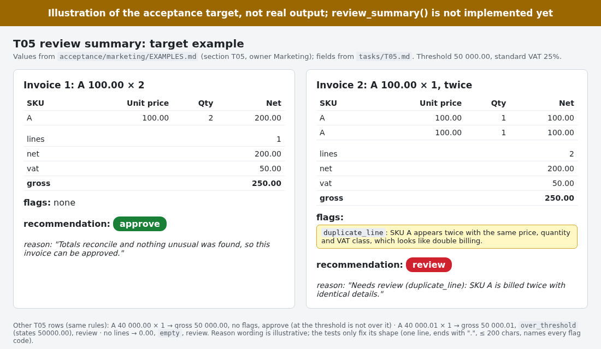
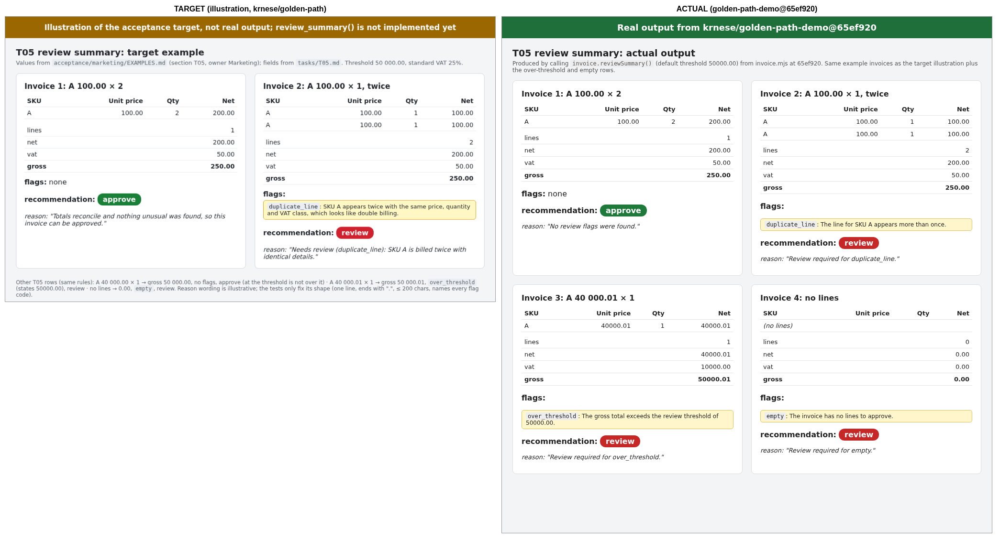
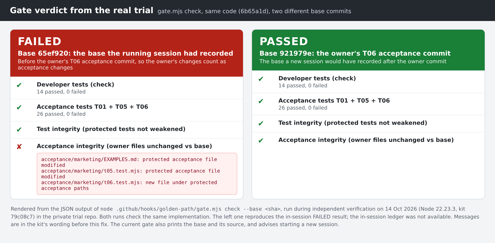

# The golden loop, end to end: a real trial

← [Golden Path README](../../../README.md) · [Documentation index](../../../README.md#documentation)

This walkthrough follows one business intent from a sentence to shipped, checked code, and then round again,
using the real artefacts from a trial run on 14 October 2026. Kristian Nese (KN) played the business owner
(Marketing). Implementation was done by GitHub Copilot's default agent in VS Code on Windows.

**The loop:** Intent → Acceptance → Review → Build → Evidence → Next intent. At every step it is clear who
decides. The owner decides what "done" means. Copilot builds to it. The gate and the reviewers check that
"done" was not quietly redefined on the way.

> **Where things happened.** Acceptance was written and reviewed in this public repository (PRs
> [#18](https://github.com/krnese/golden-path/pull/18), [#19](https://github.com/krnese/golden-path/pull/19) and
> [#20](https://github.com/krnese/golden-path/pull/20)). Implementation happened in a demo repository generated
> from it with `examples/make-demo.mjs` (the [invoice demo](../../../examples/invoice-demo/README.md) with the kit
> installed at Level 2). That demo repository, `krnese/golden-path-demo`, is **private**, so commit ids from it
> are quoted here but not linked. You can build an identical one yourself: see [Run it yourself](#run-it-yourself).

| Step | What happened | Who decided |
|---|---|---|
| 1. Intent | Marketing wrote one sentence about simple invoices | Marketing (KN) |
| 2. Acceptance | An agent outside the repository turned it into T05 criteria and tests, as a PR | Proposed by the agent, owned by Marketing |
| 3. Review | Copilot code review found gaps in the *acceptance*; fixed or deliberately deferred | Marketing approved and merged |
| 4. Build | Copilot implemented T01 + T05; 18/18 acceptance tests passed; no acceptance file touched | Copilot built; the gate and tests checked |
| 5. Evidence | Real output next to the target showed two gaps the tests allowed | Marketing judged the output |
| 6. Next intent | Marketing's follow-up became T06; round 2 shipped, 26/26; the gate refused a mid-session acceptance change | Marketing; the gate failed closed |

## Round 1

### 1. Intent

Marketing (KN), verbatim:

> "I need invoices to be as simple as possible, so humans can immediately understand and approve/reject them
> without requiring deep investigation"

**Who decided:** Marketing. Nothing was written in the repository yet.

### 2. Acceptance: from a sentence to tests the owner can approve

An agent working **outside** the repository turned the sentence into a proposed increment, T05 ("review summary
a human can approve at a glance"), and opened it as an acceptance-only PR:
[#18](https://github.com/krnese/golden-path/pull/18). It contained the task, business examples and protected
tests, and no implementation. The PR said which parts are testable proxies (fixed fields, one-sentence reason,
named flags, a 50 000.00 review threshold). It also said which parts stay human judgement: "immediately
understand" can't be a test, so Marketing reads real output instead.

To make the target concrete, the acceptance includes an **illustration** of the intended result. It is not real
output.



**Who decided:** the agent proposed; Marketing owns the result. The current files are
[`tasks/T05.md`](../../../examples/invoice-demo/tasks/T05.md) and
[`acceptance/marketing/EXAMPLES.md`](../../../examples/invoice-demo/acceptance/marketing/EXAMPLES.md).

### 3. Review: the acceptance gets reviewed before any code exists

Copilot code review on GitHub reviewed the **acceptance**, not code. It found five gaps, in four areas:

- the duplicate rule was defined twice;
- the threshold checks were not precise enough (the reason did not have to state the actual threshold);
- an empty invoice could pass with an empty reason;
- Finance was still named as owner of Marketing's part.

These were fixed. Marketing got its own acceptance path, `acceptance/marketing/`, routed to Marketing with
CODEOWNERS. A third review pass raised three more findings. The owner deferred them on purpose and merged.

T05 was then switched on in the demo's acceptance command, and the demo was ported from Python to Node.js, so it
runs on Windows with no Python ([#19](https://github.com/krnese/golden-path/pull/19)).

**Who decided:** Marketing (KN) approved and merged. Review comments informed the decision; they did not make it.

### 4. Build: Copilot implements to acceptance it cannot change

In the generated demo repository, Copilot in VS Code on Windows implemented T01 (Finance's line discounts) and
T05. Independent verification afterwards (read-only, on the pushed branch, commit `65ef920`) found:

- **18/18** acceptance tests (T01 + T05) and 12/12 developer tests pass;
- the change touches only `invoice.mjs` and its developer tests (`tests/invoice.test.mjs`, additions only);
- the acceptance files are **byte-identical** to a fresh build from this repository, and `FREEZE.sha256` checks out;
- `gate.mjs check --base main`: **PASSED** (check, acceptance, test integrity, acceptance integrity).

**Who decided:** Copilot chose the implementation. The acceptance tests and the gate decided whether it counted
as done.

### 5. Evidence: real output back to the owner

Passing tests is not the same as meeting the intent. So the real `reviewSummary()` output for the example
invoices was rendered next to the target and sent back to Marketing.



The flags were in plain words, for example "The line for SKU A appears more than once." Two gaps were visible,
and the tests allowed both:

- the one-line summary used code words: "Review required for over_threshold.";
- when several products were duplicated, only the first one was named.

**Who decided:** Marketing, by looking at the output. This is the step tests can't replace.
Full-size round-1 output: [round1-actual-output.png](round1-actual-output.png).

## Round 2

### 6. Next intent → acceptance → build, again

Marketing's follow-up, verbatim:

> "A reviewer should understand the reason without knowing any system terms, and every duplicated product
> should be named."

It became T06, again as an acceptance-only PR in this repository:
[#20](https://github.com/krnese/golden-path/pull/20) ([`tasks/T06.md`](../../../examples/invoice-demo/tasks/T06.md),
`acceptance/marketing/t06.test.mjs`). Before merge, the T06 tests were run against the round-1 code and were
**red for the right reasons** (6 failed, 2 passed), for example `"Review required for duplicate_line."` contains a
system identifier. T05 had required the summary to *contain* every flag code, which contradicts the new intent. So
three T05 checks were retired with the owner's approval, and the rest of T05 stayed the same.

The owner then added T06 to the demo on a branch (owner commit `921979e`). Copilot implemented it (commit
`6b65a1d`):

- **26/26** acceptance tests (T01 + T05 + T06) and 14/14 developer tests pass;
- only `invoice.mjs` and `tests/invoice.test.mjs` changed; acceptance files are byte-identical to a fresh build,
  and `FREEZE.sha256` (14 entries) checks out.


Full-size round-2 output: [round2-actual-output.png](round2-actual-output.png).

### The gate refused a mid-session acceptance change, correctly

The stop gate recorded **FAILED** for round 2, although every test passed. The owner's T06 commit had landed
**inside an already-running Copilot session** (it was made through the chat and carries a
`Co-authored-by: Copilot` trailer). The gate fixes its comparison commit when a session starts, so it
compared against the older base and saw the owner's acceptance changes. It cannot tell an owner's commit from an
agent's (commit authorship is not authority), so it failed closed. Copilot reported the failure instead of trying
to edit around it.

Checked against the owner's commit as the base, the same code passes:



This was the right result, but the message didn't say which base it used or what to do. That led to a fix in
the gate: a failing acceptance-integrity result now names the base and how it was chosen. When the acceptance
changes are already committed, it also says: *"These acceptance changes were committed after this session
started. If an owner made them, start a NEW chat/session so the owner commit becomes the base; the gate will not
accept acceptance changes mid-session."* The check itself is unchanged. See
[docs/LEVEL-2.md](../../LEVEL-2.md) (fixed comparison commit).

**Who decided:** the gate held the line. The owner decides what happens next: start a new session, or take the
change through the [authorised revision](../../LEVEL-2.md#changing-acceptance-tests-on-purpose-authorised-revision)
flow.

### Still open, for Marketing to judge

The wording now meets every tested rule. Whether it reads naturally is Marketing's call. Open points:

- "Products A appear more than once" uses the plural for a single product;
- "products PAPER-500, TONER-9" has no "and";
- no counts ("three times") are given; T06 makes them optional.

That would be the next intent, if Marketing wants it.

## What this trial proves, and what it doesn't

**It shows, for this run:**

- **Owner-controlled acceptance.** Business intent became acceptance that the owner reviewed, changed and merged
  before any code was written.
- **The agent built to acceptance without touching it.** Both rounds changed only implementation and developer
  tests. The acceptance files matched a fresh build byte for byte.
- **Evidence went back to the owner.** Real output next to the target exposed gaps that passing tests had
  allowed.
- **The loop refines.** The owner's next intent became new acceptance (T06), and the next build met it.
- **The gate refused a mid-session acceptance change**, failed closed, and passed against the owner's commit.

**It does not show:**

- anything beyond **one model, one task and one demo repository**, with one person playing the owner;
- that the invoices are "immediately understandable". That is human judgement, and Marketing still has open
  wording points;
- any productivity or speed benefit. Nothing was measured, and this repository's own experiments found no
  measurable benefit from method guidance ([evidence](../../evidence.md));
- that the gate stops a **dishonest** agent. Copilot never tried to change acceptance in this trial. The
  evidence for refusals is the scripted refusal scenario
  ([`simulator/refusal_scenario.mjs`](../../../examples/invoice-demo/simulator/refusal_scenario.mjs)) and the
  kit tests, not this run.

The gate's state and ledger are gitignored, so the in-session records were not available for verification. The
FAILED verdict above was reproduced afterwards with `gate.mjs check --base`.

## Run it yourself

On Windows, in PowerShell, with Node.js 22+, git and VS Code with GitHub Copilot. No Python. On current `main`
the demo already contains T05 and T06 (both rounds), and T01, T05 and T06 are all enabled and red.

1. **Build the demo repository** from a clone of this repository:

   ```powershell
   node examples/make-demo.mjs $HOME\golden-path-demo
   cd $HOME\golden-path-demo
   node simulator/refusal_scenario.mjs
   ```

2. **Owner step, on a branch, in a terminal (not in the chat).** As the owner, read
   `acceptance/marketing/EXAMPLES.md` and the target illustration in `docs/`. If you change an example or a
   test, commit it on a branch first:

   ```powershell
   git switch -c owner/acceptance
   # edit acceptance files as the owner, then:
   git add acceptance
   git commit -m "Owner: acceptance for the next round"
   $base = git rev-parse HEAD
   ```

3. **Start a NEW Copilot chat** (`code .`, then a new chat with the default agent). The gate takes its base when
   the session starts, so the owner's commit must exist *before* the chat starts. If the owner changes acceptance
   later, start another new chat.

4. **Check the result yourself:**

   ```powershell
   node --test "tests/**/*.test.mjs"
   node --test acceptance/t01.test.mjs acceptance/marketing/t05.test.mjs acceptance/marketing/t06.test.mjs
   node .github/hooks/golden-path/gate.mjs check --base $base
   git diff --stat $base
   ```

   (If you skipped step 2, set `$base = git rev-parse HEAD` before starting the chat.)

**The two prompts.**

- *To an agent outside the repository (Intent → Acceptance).* Give it the owner's sentence and ask for
  acceptance only. In the trial the sentences were the two verbatim intents above. For example:

  ```text
  Turn this business intent into acceptance for examples/invoice-demo, as a PR that changes only the task,
  the examples and the protected acceptance tests (no implementation). Say which parts are testable and
  which stay human judgement: "<the owner's sentence>"
  ```

- *To Copilot's default agent in a new chat (Build).* Point it at the task files; the skill and the gate
  supply the rest:

  ```text
  Do tasks/T01.md, tasks/T05.md and tasks/T06.md.
  ```

## Files in this folder

| File | What it is |
|---|---|
| [target-vs-actual.png](target-vs-actual.png) | T05 target illustration next to real round-1 output (`65ef920`) |
| [round1-actual-output.png](round1-actual-output.png) | Real round-1 `reviewSummary()` output, four example invoices |
| [round1-vs-round2.png](round1-vs-round2.png) | Real round-1 and round-2 output side by side |
| [round2-actual-output.png](round2-actual-output.png) | Real round-2 output (`6b65a1d`), including the T06 multi-duplicate examples |
| [gate-verdict.png](gate-verdict.png) | Gate verdicts rendered from the two JSON files below ([HTML source](gate-verdict.html)) |
| [gate-check-base-65ef920.json](gate-check-base-65ef920.json) | `gate.mjs check --base 65ef920` on `6b65a1d`: FAILED (acceptance integrity) |
| [gate-check-base-921979e.json](gate-check-base-921979e.json) | `gate.mjs check --base 921979e` on `6b65a1d`: PASSED |

---

← Previous: [Background of Golden Path](../../background.md) · Next: [How your acceptance suite grows itself](../../how-acceptance-evolves.md) →
