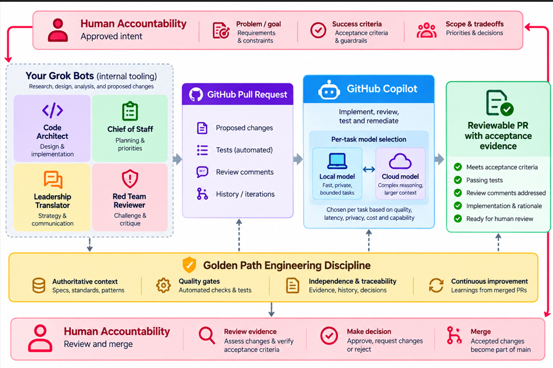

# Example: connecting your own reasoning boundaries

This is **one** adopter's workflow, Kristian Nese's (KN), shown so you can map your own. Golden Path does not
require this shape, these agents or these tools. The question it helps you answer is: *where do your agents
reason, where is the handoff, where does the model choice sit, and where do acceptance checks and humans
decide?*

## The flow, top to bottom

1. **Human accountability: approved intent.** Problem and goal (requirements, constraints), success criteria
   (acceptance criteria, guardrails), scope and tradeoffs (priorities, decisions).
2. **Your own agents do research, design and proposed changes.** Here these are KN's internal Grok bots: Code
   Architect (design and implementation), Chief of Staff (planning and priorities), Leadership Translator
   (strategy and communication) and Red Team Reviewer (challenge and critique).
3. **GitHub pull request: the handoff.** Proposed changes, automated tests, review comments, history and
   iterations.
4. **GitHub Copilot implements, reviews, tests and remediates.** Per task, the host chooses a local model
   (fast, private, bounded tasks) or a cloud model (complex reasoning, larger context), weighing quality,
   latency, privacy, cost and capability.
5. **A reviewable PR with acceptance evidence**: meets acceptance criteria, tests pass, review comments
   addressed, implementation and rationale written down, ready for human review.
6. **Golden Path discipline underneath every step**: authoritative context (specs, standards, patterns),
   quality gates (automated checks and tests), independence and traceability (evidence, history,
   decisions), continuous improvement (learnings from merged PRs).
7. **Human accountability: review and merge.** Review the evidence against the acceptance criteria, decide
   (approve, request changes or reject), merge.

## Mapping it onto Golden Path

| Boundary in the diagram | Who decides | Golden Path level and files |
|---|---|---|
| Approved intent and success criteria | Expert and engineer | L1 skill (`.github/skills/golden-path/`): Intent → Context → Boundary → Acceptance → Report. Examples written down, like [`EXAMPLES.md`](../../examples/invoice-demo/acceptance/EXAMPLES.md) in the invoice demo |
| Where your own agents reason | You; your agents propose | Outside the kit. Their output enters as a PR or an issue, nothing more |
| The PR as handoff | Normal repository rules | Your branch protection; optional `--with-ci` adds `.github/workflows/golden-path-check.yml` |
| Model choice inside the host | The host (Copilot) | Not Golden Path. The optional [local-model skill](../../plugin/optional/skills/golden-path-local-models/SKILL.md) only recommends |
| Implement until checks pass | Automation, on what you made executable | L2: `.github/hooks/golden-path/gate.mjs`, `.golden-path/config.json` (`check`, `acceptance.paths`, `acceptance.owner`, `acceptance.command`) |
| Acceptance tests the agent must not change | The acceptance owner | L2 protected paths (heuristic) plus CODEOWNERS and Code Owner review (durable); see [LEVEL-2.md](../LEVEL-2.md) |
| Review evidence, decide, merge | Humans | Your Code Owner review and required checks. Golden Path never merges |
| Learning from merged PRs | Humans, through reviewed PRs | L3 guide, [LEVEL-3-EXPERIMENTS.md](../LEVEL-3-EXPERIMENTS.md), if you want to measure it |

For this shape run for real (intent from Marketing, an outside agent writing the acceptance PR, Copilot
implementing, evidence back, a second round), see [the golden loop, end to end](golden-loop/README.md).

To start from this shape: install L1, write the expert's examples, then move to L2 with
`--acceptance-path`, `--acceptance-owner` and `--with-ci` once the examples are tests (see the
[README](../../README.md#three-adoption-levels)).

## Be clear about what is and isn't here

- **The Grok bots are KN's own internal tooling and not part of this kit.** Put whatever agents you already
  use in that box, or none.
- **"Continuous improvement" is a practice, not an automated loop.** Lessons change guidance, tests or
  config only through reviewed PRs. Nothing in the kit learns or rewrites itself.
- **Model selection is the host's job.** Golden Path neither routes nor switches models, and L2 checks run
  the same whichever model did the work.
- **The hook is fast feedback; the PR boundary is the authority.** Branch protection, Code Owner review and
  required CI decide. Passing the checks shows the executable examples are met, not that the change is
  correct for the business.
