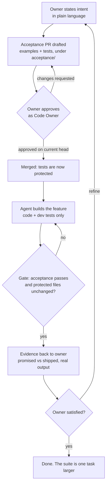

# How your acceptance suite grows itself, one task at a time

← [Golden Path README](../README.md) · [Documentation index](../README.md#documentation)

*For teams adopting Golden Path. October 2026.*

When people first look at Golden Path, they often ask: "Where are the tests? Do I have to write a big acceptance suite before I can start?" No, you don't. This article explains why, how a repository's acceptance suite builds up through ordinary use, and what that means for your team.

I've kept two kinds of statements apart throughout. **Verified** means it's backed by a file in the kit repository (`main` at `79c08c7`) or by the trial evidence, and the path is cited. **Proposed** marks ideas about where this could go. Those aren't shipped and aren't proven.

---

## Two kinds of tests, which are easy to mix up

**1. The kit's own tests ship with the kit.** `tests/kit.test.mjs` in the Golden Path repository tests the kit itself: the gate, the installer, the CODEOWNERS logic. For example, it checks that owners are read from the *base* commit's CODEOWNERS so a PR can't grant itself owners, and that team owners fail closed (`tests/kit.test.mjs`, around lines 720–760). You get these the moment you clone the kit. They tell you the guard rails work. They say nothing about your business.

**2. Your repository's acceptance tests don't exist yet.** Nobody can ship them to you, because they describe *your* rules: what a correct invoice, report or API response looks like for *your* owners. They build up over time, one task after another. Each task brings examples from the person who owns that rule, and those examples become protected tests.

The invoice demo shows this shape. Every task file points at an owner's examples and tells the agent to leave them alone. `examples/invoice-demo/tasks/T01.md` says: *"Acceptance: Ingrid's examples in `acceptance/EXAMPLES.md` (section T01) and the protected tests in `acceptance/t01.test.mjs` (tests `T01 …`). Do not change them."* T02–T06 follow the same pattern. T05 and T06 belong to a second owner, Marketing, whose files live under `examples/invoice-demo/acceptance/marketing/`. So the suite isn't written up front. It's the sum of the tasks you've done.

---

## The loop



Step by step:

1. **The owner states intent.** Plain language, from the person who owns the outcome. They don't have to be an engineer.
2. **An acceptance PR is drafted.** The intent becomes concrete examples (`EXAMPLES.md`) and executable tests under the acceptance path. Someone can write this draft, and an agent can help.
3. **The owner approves it as Code Owner.** With CODEOWNERS covering the acceptance paths, branch protection requiring Code Owner review, stale approvals dismissed, and `golden-path-check` as a required check, a change to acceptance needs an **approval on the PR's current head commit** from a Code Owner of every changed acceptance file. CODEOWNERS is read from the base commit (`docs/LEVEL-2.md`, "Changing acceptance tests on purpose"; `plugin/extras/workflows/golden-path-check.yml`).
4. **The tests are protected.** From then on, they're part of the base everything else is compared against.
5. **The agent builds and can't change them.** The local stop gate never skips: *"the agent can't revise acceptance tests"* (`docs/LEVEL-2.md`). In CI, the PR-base comparison flags any edit to protected acceptance files.
6. **Evidence goes back to the owner.** You compare what was promised with what shipped, show real output, and say plainly what the tests can't settle.
7. **The owner refines.** If the result is right by the tests but not by the owner's judgement, the owner states a sharper intent. That becomes a *new* task with *new* tests, and the loop runs again.

---

## A concrete walkthrough: T05, then T06

This part is grounded in the kit repository and the trial evidence. The public account of the trial is [the golden loop walkthrough](examples/golden-loop/README.md), and its gate verdicts are checked in as [gate-check-base-65ef920.json](examples/golden-loop/gate-check-base-65ef920.json) and [gate-check-base-921979e.json](examples/golden-loop/gate-check-base-921979e.json). Some details below come from the trial's verification notes ("round 1 notes" and "round 2 notes"), and the round 1 gate output. Those are not published in this repository. Where a claim rests only on them, it says so. The trial ran on a demo repo, `krnese/golden-path-demo`, generated from the kit's invoice demo by `examples/make-demo.mjs`. The round 2 verification found the demo's `acceptance/`, `tasks/`, `FREEZE.sha256` and CODEOWNERS byte-identical to a fresh `make-demo.mjs` build. Kit paths below are under `examples/invoice-demo/` unless stated otherwise.

**Two owners, one repo.** `examples/make-demo.mjs` writes this `.github/CODEOWNERS` into the demo (the handles are fictional placeholders):

```text
# Finance (Ingrid Berg) owns T01..T04 acceptance (acceptance/t01..t04.test.mjs, acceptance/EXAMPLES.md)
/acceptance/ @demo-finance-ingrid-berg
# Marketing owns T05..T06 acceptance on its own path (acceptance/marketing/)
/acceptance/marketing/ @demo-marketing
```

The last matching line wins, so Marketing owns `acceptance/marketing/` and Finance owns everything else under `acceptance/`. The script's own comment explains why: the kit config holds *one* `acceptance.owner` string for agent-facing messages, and *"per-path owners are expressed in CODEOWNERS"*.

**Round 1: intent becomes T05.** Marketing's intent, verbatim: *"I need invoices to be as simple as possible, so humans can immediately understand and approve/reject them without requiring deep investigation."* That became `tasks/T05.md`, the examples in `acceptance/marketing/EXAMPLES.md` (section T05), and the protected tests in `acceptance/marketing/t05.test.mjs`: a `reviewSummary()` with a fixed set of fields, flags for empty invoices, duplicate lines and amounts over the threshold, and a one-line reason.

- The agent (Copilot) changed only `invoice.mjs` and `tests/invoice.test.mjs`. Nothing under `acceptance/`, `tasks/`, `.github/`, `.golden-path/` or `FREEZE.sha256` changed (the round 1 notes, check (a)).
- `FREEZE.sha256`: all 12 entries OK. Acceptance (T01 + T05): 18/18 pass. `gate.mjs check --base main`: passed (the round 1 notes, checks (b)–(e); round 1 gate output, not published).
- **The evidence back to the owner was honest.** Every tested criterion was met. But the summary reason read *"Review required for over_threshold."*, a code rather than plain words, and only the first duplicated SKU was named. Whether that's clear enough was marked *"Partly, for KN to judge."*

That's the important moment. The tests passed, and the owner still wasn't fully served, because the tests encoded the intent only as far as it had been written down. That limit is stated in the kit's own README: *"Cases the examples don't cover are not checked."*

**Round 2: the owner refines, which becomes T06.** Marketing's sharper intent, verbatim from `tasks/T06.md`: *"A reviewer should understand the reason without knowing any system terms, and every duplicated product should be named."* T06 changes only the human-facing text. Reasons can't contain flag codes or snake_case, every duplicated SKU has to be named, and *"everything else in T05 is unchanged"*. Its tests are in `acceptance/marketing/t06.test.mjs` (eight tests, including `T06 test_every_duplicated_product_is_named` and `T06 test_t05_behaviour_unchanged`).

**How T06 supersedes part of T05.** T05 originally required the summary reason to contain every flag's code, and T06 forbids exactly that. So the two can't both stand. `tasks/T06.md` says so openly: *"This supersedes one T05 clause: the summary `reason` no longer contains flag codes (T05's test was amended to match)."* `tasks/T05.md` records the same change from its side: *"(T06 superseded the earlier rule that it contains every flag's code)"*. In `acceptance/marketing/t05.test.mjs`, that one clause had been checked in three places. Each of those three checks was removed and replaced with a `// superseded by T06` comment:

- `T05 test_duplicate_line_flagged_with_plain_reason`: *"the summary reason no longer names flag codes"*
- `T05 test_empty_invoice_needs_review`: *"the summary reason no longer names flag codes"*
- `T05 test_every_flag_has_a_reason`: *"the summary reason explains each flag in plain words instead of naming its code"* (in the round 1 run this test was `T05 test_every_flag_named_in_reason`, per the round 1 gate output (not published))

The rest of each test still runs, for example the one-sentence check on the reason. The amendment came in through the owner's acceptance commit (`921979e`, PR #3 in the demo). Inside the agent session, the gate saw that same commit as *"acceptance/marketing/t05.test.mjs: protected acceptance file modified"* plus a new `t06.test.mjs` ([gate-check-base-65ef920.json](examples/golden-loop/gate-check-base-65ef920.json)). The agent didn't retire these checks. The owner did, in a change that's visible on its own.

- Copilot's implementation commit `6b65a1d` touched only `invoice.mjs` and `tests/invoice.test.mjs`. `FREEZE.sha256` (now 14 entries) passed 14/14. Acceptance (T01 + T05 + T06): 26/26. Against the owner commit, `gate.mjs check --base 921979e` passed (the round 2 notes; [gate-check-base-921979e.json](examples/golden-loop/gate-check-base-921979e.json)).
- **The gate also failed closed, and that's worth telling.** Inside the agent session, the stop gate compared against the commit the session *started* on (`65ef920`), which was before the owner's T06 files existed. So it refused: *"protected acceptance file modified"* ([gate-check-base-65ef920.json](examples/golden-loop/gate-check-base-65ef920.json)). The verification concluded the gate *"behaved correctly and failed closed. Commit authorship is not trusted"*, because a Copilot-co-authored commit can't prove owner authority. Copilot reported the failure honestly instead of editing around it. The practical lesson: commit owner acceptance outside the agent session, then start a new chat (the round 2 notes, "Gate root cause").
- The evidence went back to the owner again, with remaining wording weak spots ("Products A appear more than once", no counts) listed for Marketing to judge.

After two rounds, the repo has more acceptance than it started with. The new tests are owner-approved, protected, and tied to a named task and a recorded reason. Nobody sat down to "write the test suite".

---

## Why it works this way

- **Owners define done.** The person accountable for the outcome approves what "correct" means. The agent and the implementing engineer work to that definition. They don't get to redefine it.
- **A living, owner-approved spec.** `EXAMPLES.md` plus the tests next to it make a specification that's readable and executable at the same time. It changes only when an owner approves a change.
- **Regression protection.** Every finished task leaves tests behind. T06 had to keep T05's behaviour, and T01's acceptance kept running throughout ([gate-check-base-921979e.json](examples/golden-loop/gate-check-base-921979e.json) lists T01, T05 and T06 all passing).
- **An audit trail.** Each test traces to a task file, an acceptance PR, and a Code Owner approval on a specific commit. You can see who decided, and when.
- **Agent-agnostic.** The binding boundary is your own branch protection, Code Owner review and required CI check. The README puts it this way: *"Golden Path adds no new gate; it connects the expert's acceptance to those existing controls."* Switch agents and the suite still holds.

---

## What it means for your team

**You don't need a big-bang test-writing project.** Start with one task. Pick a change someone actually wants, ask its owner for a handful of examples, put them under your acceptance path, add a CODEOWNERS line, and run the loop once. The suite starts at one task's worth of tests and grows from there.

**This suits brownfield repos.** Existing code doesn't need to be covered first. Acceptance builds up around the areas that are actually changing, which are usually the areas where a regression would hurt most.

**Roles become clearer.** Owners approve meaning, engineers and agents deliver behaviour, and the evidence step is where they meet. Expect owners to spend a little time reviewing examples and screenshots. That's the point.

**Practical tips from the trial (verified):**

- Use individual `@user` owners in CODEOWNERS. Teams and emails aren't resolved, so they fail closed (`docs/LEVEL-2.md`).
- Owner acceptance changes go in their own PR (the `golden-path:acceptance-revision` path in `docs/LEVEL-2.md`), and then the agent starts a fresh session.
- Use Node 22 or later. On Node 20, the `check` step failed for environment reasons (the round 1 notes, check (e)).

**The plugin direction.** The kit installs from `plugin/` (`plugin/install.mjs`, `plugin/skills/golden-path`, the optional hook in `plugin/com.github.copilot/hooks/`, and `plugin/extras/workflows/golden-path-check.yml`). The split matters:

- **The plugin brings the method:** the skill, the gate, the CI check. It's the same for every repo and is covered by the kit's own tests.
- **Each repo grows its own suite.** No plugin can bring your acceptance tests. They come from your owners, one task at a time.

---

## Many developers, one truth

When several developers (and their agents) work in the same repo at once, it helps to be clear about which result counts.

- **The source of truth is the acceptance tests on protected `main`.** They got there through an owner-approved change: CODEOWNERS plus branch protection that requires Code Owner review (`docs/LEVEL-2.md`). Nothing on a developer's laptop outranks them.
- **CI on the PR gives the authoritative verdict. A local green is a hint.** `plugin/extras/workflows/golden-path-check.yml` runs `gate.mjs check --base "$BASE_SHA"` against the PR's base commit and, for owner revisions, `authorize-acceptance-revision --base … --head …`. Its own header calls the in-session hook *"feedback, not the boundary"*. A passing local session is encouraging, but only the required check on the PR decides.
- **Tampering is visible, and the verdict can be recomputed.** Any edit to a protected acceptance file shows up in the PR diff. Because the check takes only commits (base and head) and the PR's reviews as input, anyone can rerun it and get the same verdict. That's how the round 2 verification reproduced both results ([gate-check-base-65ef920.json](examples/golden-loop/gate-check-base-65ef920.json), [gate-check-base-921979e.json](examples/golden-loop/gate-check-base-921979e.json)).
- **The ledger is a local diagnostic, never the record.** The gate writes `.golden-path/ledger.jsonl` (`LEDGER_REL` in `plugin/scripts/gate.mjs`, line 29), and the installer adds it to `.gitignore` along with `.golden-path/state/`. Each developer has their own copy on their own machine. It's useful for "why did my session block?", but it isn't committed, isn't shared, and isn't evidence for anyone else. The record is the commits, the PR, the reviews and the CI result.

**The gap: a base that moves mid-session (verified, round 2).** The local gate compares against the commit the session *started* on. If an owner's acceptance change lands while a session is open, the gate sees protected files that differ from its base and fails closed. That's exactly what happened with T06 (the round 2 notes, "Gate root cause"). It's safe but confusing. To avoid it:

- Start a new agent session after an owner's acceptance change lands. Since PR #21 the gate says so itself: a failing acceptance-integrity result now names the base it compared against and how that base was chosen (`base_sha`, `base_source`). When the changed acceptance files were committed after the session started, it tells you to start a new chat or session so the owner commit becomes the base. The check itself is unchanged and still fails closed. See [the golden loop walkthrough](examples/golden-loop/README.md#the-gate-refused-a-mid-session-acceptance-change-correctly) and [LEVEL-2](LEVEL-2.md).
- Turn on the branch-protection setting **"Require branches to be up to date before merging"**, so CI judges each PR against the latest protected `main`, including any acceptance that was merged in the meantime.

**Proposed:** commit a short per-session summary (what the gate checked, against which base, and the result) into the PR body or as a PR comment, so reviewers get the useful part of the local diagnostic without a ledger ever being stored in the repo.

---

## Honest limits

- **The evidence is narrow.** One model, one task per round, one demo repo (the round 1 notes and the round 2 notes both say so). Treat this as a working demonstration, not a study.
- **No productivity claim.** Nothing here measures speed, cost or quality against another way of working.
- **The gate didn't visibly enforce anything in round 1.** It apparently never fired, and gate state (`.golden-path/state/`, `.golden-path/ledger.jsonl`) is local and gitignored, so the repo holds no record of whether the stop gate fired. The evidence that it refuses edits comes from the scripted refusal scenario (`examples/invoice-demo/simulator/refusal_scenario.mjs`) and from the round 2 fail-closed result.
- **Drafting can be automated. Approval deliberately can't.** An agent may draft an acceptance PR. Only a Code Owner's approval on the current head makes it count, and locally the gate never skips.
- **Superseding requires owner action.** When a new task changes what an older test pinned down, the owner has to revise that older test in an approved change, as `t05.test.mjs` was for T06. The agent can't retire it, and nothing does it automatically. Today the record of it is prose in the task files and comments in the test.
- **Ownership is configured through CODEOWNERS only.** The kit config takes one `acceptance.owner` string. Per-path owners exist only as CODEOWNERS path rules, which the authorised-revision check reads with individual `@user` owners only (`examples/make-demo.mjs`, `docs/LEVEL-2.md`).
- **Tests aren't judgement.** "Immediately understandable" stayed a human call in both rounds.
- **The mid-session base is fixed by guidance, not automation.** The gate now names its base and tells you to start a new session (see [Many developers, one truth](#many-developers-one-truth)), but someone still has to do it. Nothing re-bases a running session automatically.

---

## Proposed: where this could go

*None of the following is shipped or verified.*

- **Proposed:** the agent drafts the acceptance PR straight from the owner's plain-language intent, with examples and tests, ready for the owner to approve. Approval stays human.
- **Proposed:** turn today's prose-and-comment supersede notes (`tasks/T06.md`, `// superseded by T06` in `t05.test.mjs`) into a structured field the gate or reviewer tooling can list.
- **Proposed:** owner configuration per acceptance path inside Golden Path, beyond CODEOWNERS.
- **Proposed:** a stop-gate warning *before* the fail, when acceptance commits by someone other than the agent sit between the session base and HEAD (suggested in the round 2 notes; naming the base and the new-session guidance shipped in PR #21).
- **Proposed:** a standard evidence pack (promised vs shipped, real output, open questions for the owner) produced at the end of each loop.

The short version: install the kit, pick one task, ask its owner what "done" looks like, and let the suite grow from there.

---

← Previous: [The golden loop, end to end](examples/golden-loop/README.md) · Next: [Example: connecting your own reasoning boundaries](examples/hybrid-workflow.md) →
