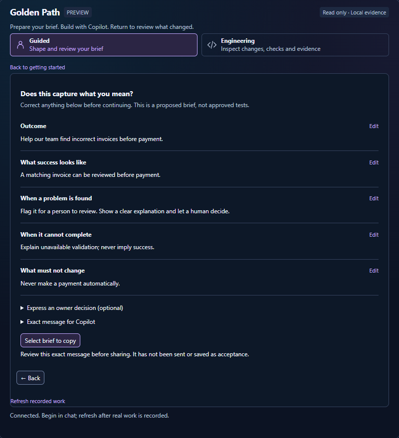
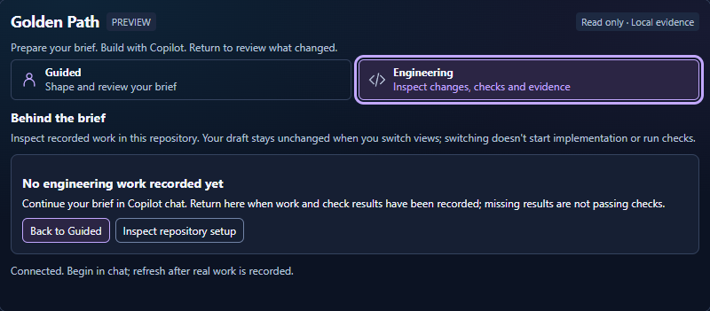

# Golden Path MCP Apps engineering inspection

An optional **briefing and read-only engineering review in VS Code**, using existing repository
artifacts rather than a parallel contract database. The default workspace server
now exposes engineering inspection and adoption inspection only. It does not
enable the older isolated draft editor or require its example model.

## Preview the two views

**Guided** prepares an editable brief for the existing Copilot conversation.



**Engineering** explains what can be inspected without starting work.
Unrecorded projects have an explicit path to full repository setup.



Local browser previews, not native-host proof. The sample brief is unshared;
neither screenshot demonstrates approved acceptance or passing project checks.
Follow the [setup, handoff and return journey](../../docs/MCP-APP-SETUP.md).
An initial inspection error keeps **Retry inspection** available outside the
snapshot-dependent views. Retrying reads artifacts only and preserves local answers.

## Two presentations, the same recorded facts

**Guided | Engineering** remains visible above the welcome screen and workspace;
either control opens its presentation directly. Switching preserves local answers.
Their descriptions explain the jobs: **Shape and review your brief** versus
**Inspect changes, checks and evidence**. Engineering's **Behind the brief**
introduction makes clear that switching does not start implementation or run checks.
A genuinely unrecorded project opens with **No engineering work recorded yet**;
**Inspect repository setup** reveals all existing technical panels and facts.
Unexpected inspection problems and recorded failures do not use that empty state.
Returning Guided work links **Review check results** directly to Evidence and
**Inspect changes** directly to Changes, preserving the local brief in both cases.
**Guided** is a single-column briefing, not a smaller engineering dashboard.
It starts with the outcome, asks one missing detail at a time, then presents
five readable brief sections with individual Edit actions. Supplied answers
are not asked again. Explicitly using a complete conversation brief goes directly
to review; using a partial one asks only for the remaining fields.
Suggested exception responses are unselected until chosen. Unknowns can be
stated explicitly rather than invented. Returning from an edit preserves all
other answers and skips their questions.

The review has one primary handoff: **Continue in Copilot chat**, or select/copy
when messaging is unsupported. The exact outgoing text is available on demand.
An optional owner expression stays separate from approval of executable tests.
There is no implementation progress stepper, evidence-count sidebar or repository
inventory in Guided. Advancing never runs checks or implements the brief.

Reopening with recorded work starts with what changed, verification freshness
and decisions needing review, rather than reopening the questionnaire. Multiple
records require explicit selection. A follow-up brief is optional and its draft
survives switching between this summary and the form. Recorded check failures,
including stale failures, and unreadable inspection records remain prominent.
Technical evidence is one explicit action away in **Engineering**.
Both presentations retain compact type, readable supporting text and larger
touch controls. Browser and host zoom are not overridden.

The same inspected artifacts distinguish **proposed**, **approved**,
**implemented** and **verified** behavior. Changed files are not completed
behavior, developer checks are not business acceptance, and unavailable approval
is never hidden behind encouraging language. **Engineering detail** exposes
the exact same records, original check output and source/diff navigation.
Switching presentations does not copy the contract or reset the entered answers.
Engineering sidebar counts distinguish current passed checks, recorded failures/skips and
checks needing current verification. A stale failure remains visible; an older
pass does not become a current success. Counts can overlap when a recorded
failure or skip also needs current verification.

**Review brief** produces a message, not acceptance files. The default is
to request owner review. A person may explicitly express an owner decision on
the meaning of the displayed behavior examples; the message makes clear this
is only for separately drafting and reviewing executable acceptance, not approval
of unseen tests or implementation. Approval must be established through the
existing owner-reviewed record and controls. The inspector does not verify the
identity/authority of a chat sender or promote that message to approved acceptance.

If the host advertises text-message support, **Continue in Copilot chat**
explicitly calls the supported MCP Apps `sendMessage` interaction. Only after
the host accepts that message does the App call `requestTeardown`; the host
decides whether to close it. Failed delivery leaves the message and App in place.
A failed close request is reported separately from successful delivery, and the
same accepted message is not resent. Otherwise, select/copy/paste works.
Nothing is sent automatically. Notes remain local to the current view, are not
written to browser storage or a separate contract store, and are lost on closing
or reloading the App. Copy them into the existing request/conversation to retain
them. Incoming inspection results never replace those notes.

### Brief, continue, return

The conversation and implementation stay in Copilot chat. The App is a briefing
and review companion, not a second chat client. Optional `brief` fields on
`inspect_engineering_session` carry a proposed starting point from the existing
conversation: `outcome`, `behavior`, `exception`, `failure` and `boundary`.
Missing fields are not invented. Guided offers an explicit **Use this draft**
action, preserving existing local answers until chosen; this never sets an
owner decision or approval. For example, ask Copilot to open the App with a
proposed brief from the discussion, then correct it before continuing in chat.

The reviewed message asks Copilot to retain the brief and evidence links in the
existing task or PR. Reopening inspects those real records, not a remembered
conversation. A returning summary surfaces baseline changes, evidence freshness,
review gaps and a useful next action. When several sessions exist, choose the
relevant work; the App does not silently select the newest. Engineering tabs
inspect recorded work; no navigation starts implementation or checks.

### Read-only repository pulse

Local inspection inventories up to 20 non-ignored workflow definitions and their
textual Action references, root package scripts, guidance, ownership declarations
and local acceptance configuration. It does not evaluate arbitrary YAML, execute
scripts, infer commands for other build systems or establish enforcement.

**Refresh GitHub**, or explicit `github: true` on the inspection tool, uses the
server's existing `gh` CLI credentials and bounded read-only github.com queries.
New REST requests explicitly use GET; branch-control facts reuse the existing
adoption diagnostic, including its repository-metadata query and paginated
rules/legacy-protection handling, rather than a second policy evaluator.
Default inspection is offline. No login, installation, credential
switching or settings changes happen automatically. Supported origins are
github.com HTTPS and Git SSH URLs; other hosts remain explicitly unknown.

Remote facts show up to five hosted workflows, recent runs on the checked-out
branch, open issues and PRs, plus effective default-branch rules and classic
protection where readable. Runs from another HEAD are historical; matching HEAD
does not validate all required application checks. The adoption diagnostic checks
the kit's named check, Code Owner review and stale-review dismissal, not a
universal repository-hardening policy. Matching HEAD also
does not validate uncommitted changes or prove all required checks passed.
Issue search may lag updates; PR listing does not establish reviews, mergeability
or required-check satisfaction. Missing authentication, tooling, permissions,
timeouts and malformed responses remain **unknown**, never empty success.
Every snapshot has sources and timestamps; it is not continuous monitoring.

**Still requiring a human trial:** a non-professional developer must demonstrate
that they can express the problem, correct and approve meaningful examples,
understand what is being built, judge the actual evidence and recognize a
decision that needs intervention without reading code. Automated UI/content
tests and browser inspection do not establish this acceptance outcome. No new
owner-approved acceptance tests have been authored in this implementation.

## Engineering review: one connected slice

For an application created from the starter, follow the
[optional setup and update instructions](../../docs/MCP-APP-SETUP.md).
`node examples/mcp-app/configure.mjs --target "<application-repo>" --dry-run`
previews the portable Copilot server entry; omit `--dry-run` to create a new
workspace-root `.mcp.json` with `mcpServers`. Existing configurations are never
overwritten: merge the preview manually if other servers or JSON-with-comments
settings already exist. Older `.vscode/mcp.json` requires explicit migration
review to avoid duplicate registrations; see
[older App registrations](../../docs/MCP-APP-SETUP.md#migrating-an-older-app-registration).
Relative arguments resolve from the application workspace root, with `--target .`;
no editor-specific variables or workspace `cwd` property are required. The helper
enables only the two read-only inspection tools, not all future server tools.
The server runs from this kit checkout but inspects only the bound application.
Method-only applications need no fabricated gate configuration; missing controls,
sessions and verification remain unavailable. After updates, rebuild, restart
the MCP server and reopen the App so server and UI versions match.

After configuration, run
`node examples/mcp-app/verify.mjs --target "<application-repo>"`.
It verifies the expected configured process, read-only tools, actual inspection,
repository binding and current App resource, without running application checks.
Modified server commands are refused pending review. Host discovery, trust and
native rendering still need to be verified in VS Code; configuration alone is
not setup complete.

A project with no local recorded sessions opens a connected welcome view rather
than a dashboard of missing evidence. Select its first-task message to copy into
chat, share it explicitly if supported by the host, or explore the guided view.
Technical details remain inspectable, and refresh shows newly recorded work.
No session, acceptance or passing result is created to populate the view.

Build with Node.js 22+ from the kit repository root:

```powershell
npm ci --prefix examples\mcp-app --no-audit --no-fund
npm --prefix examples\mcp-app run build
npm --prefix examples\mcp-app test
```

In VS Code, start/restart **golden-path-experience-preview** using **Chat: Open
Customizations > MCP Servers**. Restart the server and open a fresh chat after
migrating a registration if the current session still lists the old forwarded
server. In an MCP Apps-capable Copilot chat, ask:

> Call inspect_engineering_session and show the MCP App. Let me choose a
> recorded session, inspect its contract, acceptance, changes and evidence, and
> identify the next accountable action. Do not execute checks or modify files.

Choose a recorded session explicitly; the App never silently chooses whichever
session happens to be newest. For this checkout's ongoing real engineering
session, the recorded ID is visible in the selector. Session IDs are gate record
identifiers, not private reasoning traces or chat transcripts.

| View | Existing source | What it establishes / does not establish |
| --- | --- | --- |
| Contract | `.golden-path/state/<session>.json` `task`, linked repository document, configuration and method | Shows the recorded request verbatim, not a synthesized agreement. Missing linkage is unavailable; a link is not approval |
| Acceptance | Configured acceptance paths, file content, last path commit | Browse examples/tests and textual IDs. Owner approval, per-example execution and coverage stay unverified unless independently established |
| Evidence & findings | Retained actual gate JSON, existing integrity functions, selected gate events | Passed, failed, skipped, unverified and unavailable are separate. Historical or stale passes are not current passes |
| Changes | Git diff from the fixed recorded session base, including uncommitted and non-ignored untracked files | Actual source/diff navigation, not proof the baseline was approved or a coverage verdict |
| Why does this exist? | Exact path references, configured membership, recorded task link and shared example IDs | Verified source relationships, inferred text-ID hints and unavailable rationale are explicitly separated; no AI reasoning trace |
| Agreement delta | Changes to the linked task, acceptance, config, method, ownership and workflow/hook sources | Deterministic path-based review signals. Ordinary implementation candidates can still change intent or authority; there is no semantic enforcement or approval engine |
| Handoff | The inspected artifacts, findings and actual check statuses | Selectable report for the existing conversation/PR; nothing sent automatically and no permission granted |

Use the tabs and expandable output, not a dashboard wall of text. **Inspect
source**, **Inspect diff**, and **Why does this exist?** connect the views.
The source viewer always works within the App. **Open in VS Code** is offered
only when the host advertises `openLinks`; it requests a `vscode:` URI and shows
an explicit fallback if the host declines it. Native file-opening support must
be verified in the target client; no custom editor API is assumed. The App
supports host light/dark context and requires no external network permissions.

### Actual verification, not reconstructed evidence

Existing hook state retains a fixed base and summary outcome. The ledger records
selected mechanical events, **not complete test output or semantic delegation**.
The App never reconstructs individual passes from `gate_green` or an old
`PASSED` state.

To retain per-check evidence, explicitly run this from a trusted terminal after
reviewing the target repository's configured commands:

```powershell
node examples\mcp-app\capture-evidence.mjs --target "<application-repo>" --session "<recorded-session-id>"
```

This optional script executes that repository's existing installed
`.github/hooks/golden-path/gate.mjs check --base <recorded-base>` once and retains
its JSON under `.local/golden-path-evidence/<session>.json`. Failed runs exit
nonzero and retain the actual failures; skip/unverified fields are preserved.
The App itself cannot invoke the script. It does not modify the gate, acceptance,
session state or workflow. Ensure `.local/` is ignored in the target repository
before capturing; it is already ignored in this kit.

The envelope adds only session/repository identity, time, HEAD and the gate's
existing working-tree fingerprint before/after verification. It is local,
unsigned evidence, not an audit or approval system. Different HEAD, baseline,
fingerprint or an unstable run is labelled stale. Ignored files and external
services are outside this fingerprint; matching provenance is not proof every
test input or dependency is unchanged. Individual test skips remain visible in
the raw output even if their command exits zero; a passed command is not a claim
every test ran.

For a local real-session preview (not native compatibility proof), use:

```powershell
node examples\mcp-app\preview.mjs --target "<application-repo>" --session "<recorded-session-id>"
```

The loopback host forwards only the bound read-only tool. No separate web portal
is needed for normal VS Code use. Reports limit sessions, acceptance files and
changed files to 100 each, source inspection to 2 MiB per artifact, displayed
source/diffs to 64,000 characters and recent mechanical events to 15. Limits
and unreadable sources are explicit rather than empty successful results.

### Scope and remaining uncertainty

- The first slice supports the existing gate state/config/task convention, not
  arbitrary issue trackers or a universal intent schema. A request kept only in
  chat or GitHub is unavailable locally unless the session links a repository
  source. Missing business acceptance is shown as missing, not filled with demo
  examples or developer tests.
- GitHub inspection is explicit and read-only; it does not verify owner approval
  or authorize changes. No project-command execution, protection change,
  acceptance editing, merge or deployment is exposed by the App.
- Existing integrity heuristics are reused, not strengthened into a tamper-proof
  boundary. Contract/control path changes require human review; the absence of a
  signal is not proof no delegation change occurred.
- Actual native rendering, `vscode:` link opening and developer comprehension
  must be tried in the signed-in VS Code client. Protocol/browser tests alone
  cannot establish them. Passing checks does not prove business correctness.
- Golden Path and its existing controls work without this package.

### Observed engineering-slice validation

Local Windows/Node.js 24 validation uses this checkout's existing recorded
engineering session, not a fabricated acceptance run:

| Scenario | Expected | Observed |
| --- | --- | --- |
| Read the real session | Use its original fixed comparison base | Recorded base `91acaec2`; inspected HEAD `f5bb5c14`, including later committed and working-tree changes; not silently rebased to make the diff smaller |
| No task document or business acceptance configured | Say unavailable | Contract link absent; zero acceptance artifacts; business acceptance unavailable despite developer gate success |
| Retain actual verification | Preserve original gate output and provenance | Explicit capture reported `PASSED`, stable fingerprint; 29 configured tests plus existing integrity checks; empty acceptance path set is not displayed as passed acceptance protection |
| Edit business notes, inspect a source, switch presentation | Notes stay intact; same artifacts | Outcome retained through mode change and source read; original configuration displayed with source text; no repository write |
| Why / agreement inspection | Source-backed links separate from meaning | Exact path-reference links labelled verified, text-ID associations inferred, missing rationale unavailable; control-source changes surfaced for review |
| Guided proposals | Readable examples, no silent approval | Normal/exception/failure/boundary answers appeared in the review message; unsupported host chat sharing hidden, select/copy fallback available |
| Focused journey | One question at a time; revisitable local decisions | Selected an exception response, answered the remaining questions and generated the same proposal; mode switches retained answers; stage movement did not send messages or approve anything |
| Reference-style responsive layout | Two columns where useful, stacked on narrow screens | Guided view checked at outer widths 320/390/600/768/1000; no horizontal overflow. All seven engineering views checked at 320/390/600/1000; no horizontal overflow |

`npm --prefix examples\mcp-app run build` and
`npm --prefix examples\mcp-app test` passed with **52 tests, no failures or skips**.
The tests cover all evidence statuses, stale/foreign/unstable captures, missing
contracts, changed acceptance, terminal failures, bounded source access, real
stdio tools/resources, guided proposal safety and actual UI script execution.
This is developer evidence for the implementation, not a non-professional user
study, business acceptance or a substitute for the pull request's CI results.

## Earlier isolated draft-review experiment

The following describes the separate example editor. It is not the engineering
contract or the default server configuration. To enable it explicitly, start
`server.mjs --target "<repo>" --state "<initialized-example-file>"`; this exposes
the bounded example writes in addition to the read-only inspection tools.

An optional shared decision workspace, not another reasoning agent. Inspect a
requirement or assumption, see its linked components/requirements, edit the draft
statement and rationale, then save it into **the same persisted model the
conversation reads**. There is no separate App model or browser storage.

The first slice uses an explicitly isolated example, not real business acceptance.
The usual method, required CI and owner judgment remain authoritative. The
prototype cannot approve, merge, deploy, edit acceptance, run project checks or
change GitHub settings. Dependencies are isolated here, not added to the core kit,
installer or starter template.

## Designed for the person who owns the decision

The primary journey is **understand what matters → challenge assumptions →
revise a draft → continue the conversation**. People should not need to
understand MCP, JSON, revisions or component identifiers to review the wording.

- **Plain language first.** Requirements appear under "What matters"; assumptions
  under "What we're assuming", explicitly distinguished from proven facts.
  Prompts explain what to write and why. Technical source details are secondary.
- **Context, not a document maze.** Requirements show connected parts and the
  assumptions behind them. Assumptions link back to affected requirements.
  These links are context, not evidence that a requirement has been met.
- **Deliberate changes.** Explicit save, field validation, visible saved/unsaved
  state, and confirmation before discarding edits. Inputs are read-only during
  save/reload so an in-flight response cannot erase newly typed text. Incoming
  conversation results do not replace a dirty form.
- **Task first, not a landing page.** A compact heading and grouped picker lead
  straight to the wording and reason. Save, discard and discussion actions stay
  together. Connections, guidance and source details expand only when needed;
  they do not precede the work or imply completed steps.
- **A clear next action.** "Discuss with agent" produces a selectable
  prompt from the last loaded saved model, never unsaved form text. It asks the
  agent to re-read the source, discuss uncertainty, obtain missing examples of
  success, and return actual evidence to the owner. It does not send anything,
  claim completed stages, or create a parallel report/approval store.
- **Small screens and keyboard.** All views use a grouped item picker rather
  than forcing people through a long navigation list before each edit. Fields
  have visible labels, explanatory text, keyboard focus and inline errors.
- **One visual language.** A shared, bundled palette uses deep navy surfaces,
  cyan actions, violet selection and restrained gold notices, inspired by the
  supplied architecture reference. The local preview defaults to dark; the Apps
  retain a complementary light palette when the native host requests it.
  Accents reinforce text labels, never replace them. Palette regressions check
  text contrast of at least 4.5:1 and control/focus contrast of at least 3:1.
- **Golden Path remains the method.** An optional explanation maps the experience
  to Intent, Context, Boundary, Acceptance and Report, without a mandatory wizard
  or green completion badges. Owner judgment and existing engineering controls
  remain outside the App.

The seed is still a toolkit example, not a researched customer workflow.
This UX is a design hypothesis: no non-engineering participant study, business
outcome measurement or full accessibility audit has been performed. Before
broadening it, observe a decision owner trying to explain the intent, challenge
an assumption and return to the conversation without coaching. Check whether
they distinguish saving from approval and missing evidence from success.
Diagrams and additional stages should earn their place through those tasks,
not through feature completeness.

## Build once

From the kit repository root, with Node.js 22+:

```powershell
npm ci --prefix examples\mcp-app --no-audit --no-fund
npm --prefix examples\mcp-app run build
npm --prefix examples\mcp-app test
```

Initialize the example **once**:

```powershell
npm --prefix examples\mcp-app run init-demo
```

This explicitly creates `.local/mcp-app/architecture.json` in this checkout.
That directory is gitignored. Existing models are refused, never reset or
overwritten. The seed [example-model.json](example-model.json) remains unchanged.
Use `node examples\mcp-app\init-demo.mjs --state "<new-file>"` for another example.

In another shell, use your OS's path separators. Built HTML includes its scripts
and styles; the Apps request no external network/resource permissions.

## Try it in VS Code

The default [.mcp.json](../../.mcp.json) entry is read-only. For this
older editor, explicitly add `--state` and the initialized example file to a
separate server configuration, and explicitly allow its `inspect_architecture`
and `update_architecture_draft` tools. The default allowlist intentionally excludes
them. It does not install Golden Path into another project or enable a
check/approval policy.

1. Build and initialize the prototype first.
2. Open **Chat: Open Customizations > MCP Servers**, select the separate editor
   server, and start it. Review VS Code's trust/permission prompts.
3. In Copilot's normal agent, ask:

   > Inspect the example architecture requirements and assumptions with
   > inspect_architecture. Show the MCP App so I can challenge the assumptions and
   > revise a draft. After my changes, reload the persisted model and explain
   > their implications. Do not approve anything or change real acceptance.

4. Choose `R1` under **What matters**, edit its wording/reason and **Save draft**.
   Choose `A1` under **What we're assuming** to challenge an
   assumption. Select `R2` or `A2` to inspect a locked baseline example.
5. Use **Discuss with agent**, select/copy the prompt and paste it into
   the conversation. Unsaved edits are explicitly excluded from that summary.
6. Ask Copilot to call `inspect_architecture` again. It must see the revision and
   content saved by the App, then reason from that state rather than a chat-only
   or UI-only copy.

An MCP Apps-capable VS Code/Copilot client is required for rendering. Plain MCP
clients still receive text and structured state. A successful stdio test or
browser preview **does not establish native VS Code rendering or hook behavior**.
Record the actual VS Code version, chat renderer, tool invocation and any errors
when judging that experience.

`--target` fixes the application repository for the separate read-only adoption
tool. Optional `--state` fixes the isolated architecture example file. Neither
path can be redirected through tool arguments. This prototype does not adapt or
invent an architecture model for a customer's existing records.

## One source of truth, bounded writes

- `inspect_architecture` reads the current JSON model for both chat and the App.
- `update_architecture_draft` writes only a draft statement and rationale, using
  the inspected `expectedRevision`. IDs, status, traceability links and baseline
  entries cannot be changed through this operation.
- Stale saves are rejected. A cross-process lock serializes writers and an atomic
  file replacement prevents readers from observing a partial JSON document.
- A successful save returns the persisted model with its new revision. When the
  host supports it, the App also sends a model-context freshness notification.
  That notification does not prove the agent reloaded or understood the change.
- The agent remains responsible for re-reading current state, reasoning,
  explanation and escalation. A revision is not an approval or signed audit log.
- Baseline items are **locked examples**, not a claim that a business owner
  approved this model. Filesystem access can bypass application rules; this is
  not a new authorization boundary.

If a process crashes while holding `<state-file>.lock`, saves fail explicitly.
Inspect the file and ensure no writer is running before manually removing that
specific stale lock. No automatic lock takeover or silent recovery is performed.

## Local visual preview

```powershell
node examples\mcp-app\preview.mjs --target . --state .local\mcp-app\architecture.json
```

Open <http://127.0.0.1:4328>. Stop with Ctrl+C. This local host uses the real stdio
MCP server, reads its UI resource and connects the official App/AppBridge SDKs in
a sandboxed iframe. The host is deliberately labelled **not VS Code**. It binds
only to loopback, refuses foreign origins and forwards only the bound inspection
and draft operations. It has no reasoning agent or real Copilot conversation.
It is a development aid, not a general-purpose MCP host.

Omit `--state` to preview the original **read-only adoption report** instead.
Its `inspect_golden_path_adoption` tool still never writes files or runs project
checks; it does not gain architecture-editing effects.

## What to validate

| Interaction | Expected observation |
| --- | --- |
| Inspect requirements and assumptions | Statement, rationale, status and traceability from one model |
| Edit and save a draft | Persisted revision increases; an independent MCP client sees the same content |
| Save against an older revision | Explicit conflict; newer content is not overwritten |
| Inspect a baseline item | Read-only fields; save cannot change it |
| Reload after another client's edit | The same latest persisted model appears |
| Leave a draft with unsaved edits | Confirmation offers keep editing or discard; cancel retains the proposal |
| Prepare a conversation handoff | Saved content/version only; explicit reread and missing-evidence/owner-judgment guidance |
| Empty or whitespace-only draft | Inline field error and focus; no save |
| Inspect raw state | Exact model snapshot, not an independent representation |
| Tool/connection failure | Explicit error, not a successful save or reload |
| Small screen and keyboard | Readable controls, visible focus, no horizontal overflow |
| Native VS Code rendering | Actual embedded app, not merely a text fallback or local browser |

These are developer validation scenarios, not owner-approved business acceptance.
There is no approve, install, edit-acceptance, run-checks or merge action. Nothing
is published or sent to GitHub. Architecture diagrams, boundary/authority-path
comparison, change-impact analysis and evidence/Touchdown review are future
slices, not features claimed by this first experiment.

## Observed local results

### Initial shared-state trial

Local validation on Windows with Node.js 24, 28 October 2026:

| Scenario | Expected | Observed |
| --- | --- | --- |
| App saves `R1` draft | One persisted revision change | Revision `0` to `1`; App reported saved, not approved |
| Independent stdio MCP client reads | Same state as the App/file | Exact JSON equality; baseline examples unchanged |
| Independent client edits `A1` | App and client share the source | Persisted revision `1` to `2` |
| App saves its stale revision `1` | Reject without overwriting revision `2` | `Model revision changed from 1 to 2`; unsaved proposal retained |
| Explicit discard/reload | Read current persisted state | Revision `2`, including the independent assumption edit |
| Baseline inspection | No editable baseline | Read-only fields and disabled save; API rejection covered by tests |
| Narrow screen and keyboard | No horizontal overflow; usable form | 343px document width matched 343px viewport; Tab moved between labelled fields |
| Clean install/build/protocol regressions | Reproducible, real stdio/resource behavior | `npm ci`, build and all 20 tests passed |
| Native VS Code rendering and conversation | Signed-in client validation | Not established by these local tests |

These are engineering observations, not proof of improved decisions, agent
understanding, productivity or owner approval. The local host acknowledged a
freshness notification but has no Copilot conversation. A CI matrix is configured;
these local results are not a published PR check record.

### Curated review UX

Further local validation on Windows with Node.js 24, 28 October 2026, using an
isolated throwaway model for writes (the live example was left unchanged):

| Scenario | Expected | Observed |
| --- | --- | --- |
| Switch away from unsaved edits | Ask before discarding; keep editing retains the proposal | Keyboard-opened dialog focused Keep editing; cancelling kept the text |
| Saved-state handoff while editing | Do not smuggle unsaved text into the summary | Saved text/version included, unsaved proposal excluded, warning shown; whole prompt selectable |
| Whitespace-only statement | Explain the field error without a server write | Inline error, invalid state and focus on the statement |
| Save while a response is delayed | Prevent edits being lost to an in-flight response | Fields read-only while waiting; real save advanced the isolated model from version 0 to 1 |
| Independent conversation update | Do not overwrite an unsaved proposal | Real update advanced to version 2; an injected tool-result notification left the proposal intact and displayed an update notice |
| Save an older version | Reject and preserve the proposal | Real MCP server rejected version 1 against 2; confirmed reload displayed version 2 |
| Save/reload endpoint failure | Explicit error; retain the proposal; no false success | Injected HTTP 503 responses preserved edits; persisted version stayed 2 |
| Incoming conversation error | Surface the failure without erasing edits | Injected error notification displayed explicitly; proposal retained |
| Narrow navigation and keyboard | Direct item choice, safe cancellation, no horizontal overflow | Grouped picker; cancelled switch retained A1 and its proposal; Tab moved from statement to reason |
| Responsive widths | Document width equals available App viewport | 290/290px, 359/359px and 1120/1120px at outer widths 320, 390 and 1280px |
| Field contrast in light/dark themes | Text at least 4.5:1; control boundary at least 3:1 | Text 13.03:1 / 12.03:1; boundary 3.49:1 / 4.41:1 against the field background |

`npm --prefix examples\mcp-app run build` and
`npm --prefix examples\mcp-app test` passed with **26 tests, no failures or skips**.
The configured Golden Path check and both integrity checks passed; the related
site/CI-template run passed all 30 tests. Existing protected tests were not
modified. Saves use explicit button actions: native HTML form submission is
forbidden in the sandbox, so widening sandbox permissions was not necessary.

These are local developer observations, not CI results or a full accessibility
audit. Native signed-in rendering, non-engineering comprehension, actual agent
re-reading and sustained intent-to-outcome benefit remain unproved.

### Reference-palette refinement

The original review palette (including the contrast figures above) was replaced
with the supplied reference's navy/cyan/violet/gold direction. All three views
embed the same stylesheet; no external resource permissions were added.
Build and all **29 prototype tests passed**, including both palettes' contrast
thresholds and self-contained theme embedding. The configured gate passed.
Browser checks applied light/dark host-context notifications and found no
horizontal overflow at outer widths 320, 390 and 1280px. The live example stayed
at version 2. Native-client rendering remains a separate validation.

Pre-PR regression checks also cover full-length Unicode drafts, a request split
inside a UTF-8 character, and oversized-request refusal without a state change.
The preview accepts at most 128 KiB per draft request and decodes only after
assembling the bounded bytes. All **31 prototype tests passed**.
